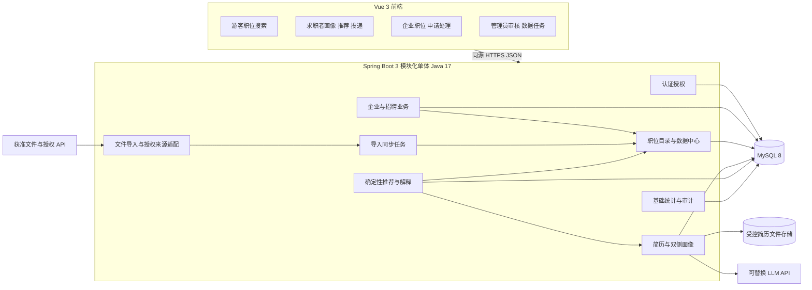
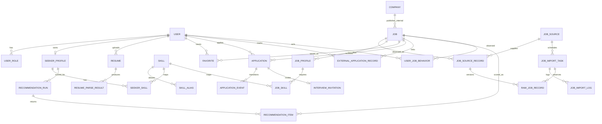
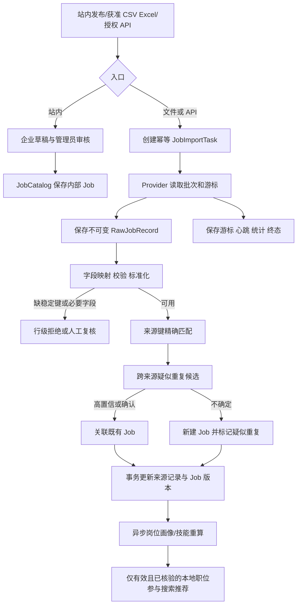
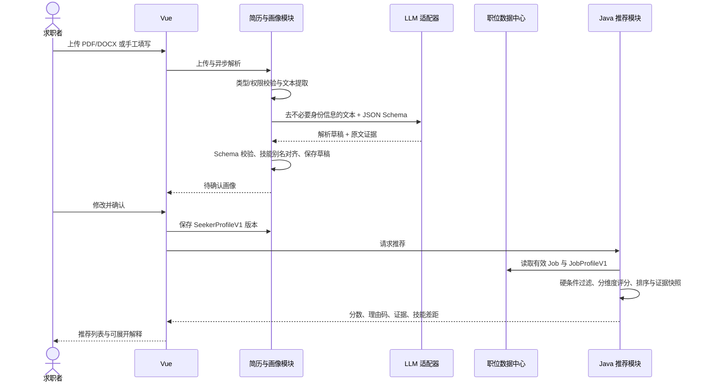
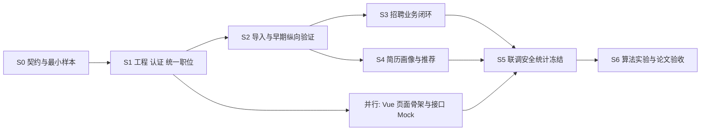

# 智能职位推荐系统总体开发实施蓝图 V2

> 状态：正式编码前的实施基线草案，2026-11-01。适用工程：`毕设主项目/`。本文件确定模块边界、数据与接口契约、开发依赖和验收门槛；详细字段长度与 UI 样式可在对应阶段微调，但跨模块契约变更必须同步更新本文件、迁移脚本和契约测试。

## 1. 资料、现状与约束

### 1.1 核查结果

| 资料或目录 | 核查结果 | 对规划的影响 |
|---|---|---|
| `毕设主项目/` | 当前为空目录，无前端、后端、数据库迁移、配置或测试；不存在可继承的业务代码 | 首阶段从可运行工程和最小纵向链路开始，目录/类名均为拟建 |
| `docs/thesis_design_v2.docx` | 已读完整正文与 6 张表；V2 冻结三角色、真实数据三入口、本地职位库、AI 解析确认、解释型规则匹配和站内招聘闭环 | 本蓝图的产品及技术基线；V2 新增数量指标是内部规划，并非导师批准要求 |
| `source_md/*毕业设计任务书.md` | 正式任务书要求三角色、用户管理、画像与行为数据推荐、收藏、投递、面试、统计、测试与部署 | 最终验收不得遗漏行为数据、管理员统计与完整业务流转 |
| `source_md/*开题报告书.md`、`*论文综述.md` | 先画像内容匹配，再利用行为与条件允许的协同过滤；结果应可解释、可测试 | 算法实验应比较基线与增量，不能把模拟数据结果表述为真实录用率 |
| `docs/参考项目技术研究报告.md` | 已记录五仓库固定提交、模块证据、许可与运行未验证边界；本轮按关键源码二次核查 | 只把与本系统有关的处理逻辑转译为 Java，避免重复研究整个仓库 |
| `毕设项目参考/` | 五仓库均存在；用户所写的“毕设参考项目”在当前工作区不存在，实际目录名为 `毕设项目参考` | 引用以下源码路径均相对于各仓库根目录 |

本轮为静态审查，没有运行参考程序、调用招聘 API、安装依赖或验证外部模型效果。源码中的“已实现”仅表示可追踪到调用链。主项目为空，本文所有 Java 类与表名是待实施设计，不应表述为现有实现。

### 1.2 需求优先级与显式差异

1. 正式任务书要求“画像、职位要求和行为数据”参与个性化推荐；V2 将行为偏好和协同过滤列入第二阶段。**决定：第一版建立 `user_job_behavior` 并记录浏览、收藏、投递和负反馈，先交付画像规则匹配；联调后补充可开关的简单行为重排并做对比，协同过滤以数据量和时间为条件。**最终验收前与指导教师确认行为算法的最低要求。
2. 开题报告较早版本把 LLM 作为可选扩展，用户已明确将 V2 作为当前开发基线；**决定：第一版实现真实的结构化简历解析与人工确认，模型不可用时能手填画像。**不把 LLM 当作匹配分数来源。
3. V2 的 50 条核验样本、300—500 条后续目标和 12 月底冻结均为内部里程碑；正式任务书的 2027-03-15 初稿/验收准备节点优先。外部授权未落实时，应如实展示站内职位与获准文件导入，不能把模拟数据冒充真实来源。

## 2. 总体架构与技术决定



| 决定 | 推荐方案与原因 |
|---|---|
| 工程形态 | 一个 Spring Boot 服务、一个 Vue SPA、一个 MySQL 实例；Java 以包划分模块。部署、调试和事务边界直观，符合 V2 单体约束 |
| 前端 | Vue 3 + Router + Pinia + Axios + Element Plus；只维护展示状态与表单，业务权限和最终校验在后端 |
| 数据访问 | Spring Data JPA 处理常规实体，复杂筛选用显式 SQL/Repository；Flyway 版本化迁移，禁止依赖自动建表作为正式升级方案 |
| 鉴权 | Spring Security、同源 HttpOnly 会话 Cookie、CSRF 防护、角色与对象归属校验；开发阶段使用 Vite 代理，部署同源反向代理，避免把令牌持久化在浏览器脚本空间 |
| 后台任务 | 单实例 `@Scheduled` 扫描持久任务表 + 有界线程池；任务行租约、幂等键、心跳与恢复。第一版无需 Quartz、Redis、消息队列 |
| 文件与外部调用 | 简历文件在非静态目录按随机 ID 存放，DB 仅存路径标识/元数据；PDF 文本提取 + Apache POI 读取 DOCX/Excel；LLM 与授权 API 用 `RestClient`，设置超时、重试上限、速率限制。旧式 `.doc` 须先验证解析器，未支持时明确拒绝并提示转为 DOCX/PDF |
| 推荐 | MySQL 候选查询 + Java 规则评分；初始权重和阈值版本化，使用人工标注样本校准。向量库、复杂 Agent 和自动跨平台投递不进入第一版 |

后端包建议：`com.yhs.jobrec.{auth,company,job,ingestion,task,resume,profile,skill,recommendation,application,admin,common}`。每包内部用 `api / application / domain / infrastructure` 分层即可，不拆成多个 Maven 服务。公共层只放身份、错误响应、分页、时钟和存储抽象；各模块不得另造 `Job`、`Skill` 或评分 DTO。

### 2.1 依赖方向

- `ingestion → job + skill + task`：Provider 提供来源原始数据，统一入口完成映射、校验和写库。站内发布通过 `job` 的领域命令创建同一 `Job`，保留企业审核与权限语义，不经过外部采集 Worker。
- `resume → profile + skill`：解析草稿经用户确认后才更新求职者画像；LLM 适配器不知道推荐模块。
- `profile → job + skill`：岗位画像读取规范职位/JD，写版本化画像与技能要求。
- `recommendation → job + profile + skill`：读取已确认的画像与有效职位，计算并保存证据快照，不回写职位或简历。
- `application → auth + company + job + resume`：只处理站内职位；外部跳转和手动进度属于求职者个人记录。
- `admin → 各模块的应用服务`：管理员调用专用服务，不跨包直接修改表。

## 3. 五项目功能映射与借鉴边界

下表源码路径相对各仓库根目录。项目的 README 声明、静态代码存在与真实运行通过是三个不同证据层级。

| 我们的功能 | 源码及实际数据/调用逻辑 | 依赖的数据结构与本系统接口 | 处理结论 |
|---|---|---|---|
| 多来源接入与统一字段 | zhipin-shield `core/models.py:24` 的 `JobPosting`；`collect/adapters/base.py:12` 的 `BaseAdapter.search(SearchQuery)`；`core/aggregators.py:16` 顺序合并、异常跳过；`collect/adapters/real_skeleton.py:49` 实际读取已采集 JSON | 原结构为 `JobPosting`、`SearchQuery`；转为 `JobSourceProvider.fetch(FetchRequest) → RawJobBatch`，再交 `JobIngestionService` | 借鉴接口边界，Java 自主实现；未把其 JSON 桥接认作稳定 API |
| 规则评分与理由 | zhipin-shield `score/matcher.py:315` 命中技能、经验/学历与理由；`:451` 加权评分和排序 | 原输入职位字典、候选人配置；我方使用 `SeekerProfileSnapshot + JobProfileSnapshot → MatchResult` | 借鉴分维度证据；不用原项目固定求职者偏好与权重 |
| 清洗与来源键 | job-crawler `backend/app/crawler/pipeline.py:10` 映射字段，`:50` 解析薪资，`:91` 分城市；`backend/app/models/job.py:7` 对来源+ID 设唯一约束；`crawler/engine.py:112` 先查后更新 | 原 `Job` 混合来源与规范字段；我方拆成 `RawJobRecord`、`JobSourceRecord`、`Job`，事务性 upsert | Java 重写并增加并发唯一约束、原文保留和跨来源候选合并 |
| 任务、日志与定时 | job-crawler `backend/app/api/v1/tasks.py:50` 创建后台任务、`:85` 进程内停止；`models/task.py:7` 保存统计/整段日志；`crawler/scheduler.py:82` 定时执行，`:109` 有错误也写 success | 原 `Task`/`CrawlerRule`；我方 `JobImportTask`、`JobImportLog`、租约/检查点、部分失败终态 | 借鉴生命周期，修正不可恢复停止和终态误判 |
| 职位详情和检查点 | ZhaopinData `zhaopin_crawler.py:177` 八字段详情字典，`:456` CSV，`:517` 每 8 页保存；CSV **没有来源链接或稳定平台 ID**，抓取成功仅以任意非空字段判断 | 原脚本内 `job_data` 列表；我方导入模板强制声明来源、许可依据与稳定记录键/URL，行级校验+检查点 | 只借鉴字段和检查点思想；GPL-3.0，绝不复制脚本；样例 CSV 本身不足以证明可追溯职位 |
| 任务派发与来源 JSON 映射 | JobCrawlerSystem `Django/CrawlerOperationProject/crawler_task/tasks.py:11` 发送后阻塞等待；`Scrapy/JobCrawlerProject/JobCrawlerProject/spiders/bossSpider.py:118` 映射 `jobName`、`salaryDesc` 等，`:153` 详情请求注释；`pipelines.py:52` 仅插入 | 原 `BossSpiderTask`/`BossSpiderItems`；我方 Controller 返回任务 ID，Worker 更新状态，来源 DTO 经同一 ingestion | 借鉴步骤；不采用其同步等待、无去重入库或未接通的详情链路 |
| 简历解析与标准化 | RoleFit `career-planner/backend/app.py:1224` OCR 后分基础、经历、技能提取，失败回退视觉；`tag_aligner.py:9` 搜索标准标签并对齐 | 原画像 JSON 与标签中心；我方 `ResumeParseDraftV1 → SeekerProfileV1`，`SkillResolver` 统一 ID | Java 自主实现，先文本提取，图片扫描件再走 OCR；人工确认后生效 |
| 岗位画像与推荐证据 | RoleFit `job-admin/backend/job_profile_schema.py:137` 岗位画像结构，`:530` 规范化；`backend_app/match_config.py:44` 评分权重；`matching_service.py:1277` 分类命中/缺失/等级不足，`:2737` 评分和 LLM insight 分离 | 原 `jobProfile`、标签向量、`match_details`；我方 `JobProfileV1 + SeekerProfileV1 → ScoreBreakdownV1` | 借鉴结构化与解释；第一版不用 Qdrant/NumPy 语义召回和固定 90/10 权重 |

许可核查：RoleFit 有 MIT 文件；ZhaopinData 有 GPL-3.0 文件；zhipin-shield、job-crawler 的 README 虽称 MIT，未发现独立许可证文件；JobCrawlerSystem 未发现许可证文件。全程只参考思想和字段，不复制任何第三方实现。未运行依赖扫描，选定依赖后再核验许可证与漏洞。

## 4. 数据模型：单一语义与身份规则

### 4.1 核心对象及关系



| 对象 | 职责与关键字段 | 唯一性、索引、生命周期 |
|---|---|---|
| `user`, `user_role` | 身份、角色、启停；角色 `SEEKER/COMPANY/ADMIN`。同一账号可按授权关联多个角色 | 登录标识唯一；禁用不级联删除业务记录；`user_role(user_id, role)` 唯一 |
| `company` | 企业资料、审核状态、管理员可处理的归属；负责人用户 FK | 企业登记标识或管理员确认的唯一键；`owner_user_id` 索引；停用企业时阻止新发布 |
| `job` | 统一职位主体：`id`、`company_id?`、`company_name_snapshot`、`title`、`direction_code`、`job_type`、`work_mode`、`city_code/district`、`salary_raw/period/months/min_monthly/max_monthly`、`education_min`、`experience_min/max`、`description`、`status`、`publish_at/expire_at/last_verified_at`、`version` | PK ID；`(status,job_type,city_code,expire_at)`、`(direction_code,status)`、企业+状态索引。内部岗位 `company_id` 必填；外部只保留来源企业名称，未经审核不得伪装本站企业 |
| `job_source` | 来源配置：`code`、`kind=INTERNAL/FILE/API`、授权说明、启用状态、刷新频率、展示名称、TTL 策略 | `code` 唯一。API 凭据只从安全配置读取，不进表；授权未落实标记 `DISABLED` |
| `job_source_record` | 同一来源职位的稳定身份与当前映射：`source_id`、`external_key`、`original_url`、`job_id?`、`first_seen_at/last_seen_at/last_verified_at`、`source_status`、`latest_raw_id` | `(source_id,external_key)` 唯一，`job_id` 与 `source_status` 索引。一个 `job` 可关联多个来源记录；来源记录下架保留历史 |
| `raw_job_record` | 每次获取的不可变原始快照：任务 FK、来源 FK、来源记录 FK 可空、行号/游标、原始 JSON、内容哈希、校验错误、获取时间 | `(task_id,row_key)` 唯一，任务/来源索引；保留失败行以供复核，长期保留期按隐私和存储预算配置 |
| `job_import_task`, `job_import_log` | 文件/API 同步任务，触发类型、状态、游标、总数/成功/拒绝/更新数、心跳、租约、错误分类；日志逐条存储 | `idempotency_key` 唯一，`(source_id,status,created_at)` 索引；终态 `SUCCESS/PARTIAL_FAILED/FAILED/CANCELLED`，不删除审计记录 |
| `resume` | 用户上传的 PDF/DOCX 文件元数据、文件哈希、提取文本的受控引用、解析状态；允许多份文件 | `(user_id,created_at)` 索引；仅属主或授权处理者可读取，删除文件与数据库引用按保留策略同步 |
| `resume_parse_result` | 每次模型调用的草稿：`resume_id`、`schema_version`、`model_version`、`prompt_version`、受控 JSON、原文证据、错误、创建时间 | `(resume_id,created_at)` 索引；草稿不可覆盖；失败仍可保留不含敏感正文的诊断信息 |
| `seeker_profile`, `seeker_skill` | **用户确认后的**唯一当前画像：目标方向/工作类型/城市/薪资/学历/经验、版本、确认时间；技能 FK、等级 `1..4`、证据来源 | `seeker_profile.user_id` 唯一；`(profile_id,skill_id)` 唯一；新简历解析不自动改写画像，确认后版本 +1 |
| `skill`, `skill_alias` | 标准技能 ID、类别与别名归一化，如 SpringBoot/Spring Boot | `(category,normalized_name)`、`(category,normalized_alias)` 唯一；未知词先候选审核，不自动创造重复标签 |
| `job_profile`, `job_skill` | 按 `job.version` 生成的岗位画像版本、结构化 JD/基础要求与提取来源；必需/加分技能、等级、原文证据 | `(job_id,profile_version)`、`(job_profile_id,skill_id,requirement_type)` 唯一；修改 JD 使旧画像失效并重算，历史不覆写 |
| `favorite`, `user_job_behavior` | 收藏唯一关系；行为事件含浏览、收藏、投递、不感兴趣、时间与归因 | `favorite(user_id,job_id)` 唯一；行为 `(user_id,occurred_at)` 索引；取消收藏不抹掉必要行为统计但遵循删除策略 |
| `application`, `application_event`, `interview_invitation` | 站内投递、每次状态转移、面试时间及回复；投递锁定当时简历 ID/版本 | `application(seeker_user_id,job_id)` 唯一；企业/求职者+状态索引。仅内部且已审核在招职位可投递；事件追加不覆盖 |
| `external_application_record` | 求职者对站外职位的**手动**投递进度与备注；不代表站外实际状态 | `(seeker_user_id,job_id)` 唯一；仅求职者本人可修改，职位失效后保留历史 |
| `recommendation_run`, `recommendation_item` | 一次推荐的用户画像版本、算法权重版本、候选范围、时间；每个结果保存职位/画像版本、分项分、证据与理由码 | `(run_id,job_id)` 唯一；用户+时间索引；结果是快照，职位变更后旧结果仍可审计但前端应重新校验当前可见性 |

`recommendation_item` 的 `score_breakdown_json` 与 `explanation_json` 是版本化结果快照，避免为了每个维度建立许多稀疏表；可检索的总分、名次和 `job_id` 则单列。管理员评估集另建 `evaluation_case/evaluation_result`，与用户真实推荐日志隔离。

### 4.2 四个必须固定的跨模块契约

**统一职位 `JobV1`**：所有入口最终共享 `job.id`，规范字段至少包含方向、类型、城市、薪资原值及月薪等价区间、学历、经验、JD、有效状态与时间。来源身份只属于 `job_source_record`；新平台只增加 Provider 和字段映射，不修改推荐输入或核心职位表。未知薪资/学历必须用 `null/UNKNOWN`，不得写成 0 或“无限制”。

**双侧画像**：`SeekerProfileV1` 和 `JobProfileV1` 共享 `skillId + level(1..4) + evidence`、方向与工作类型字典；求职者画像还含意向城市/薪资，岗位画像还含硬性要求与必需/加分技能。`resume_parse_result` 是草稿，`seeker_profile` 是用户确认的业务真值；`job_profile` 由规范 JD 和可校验 AI/规则提取构建。

**推荐输入输出**：`MatchInputV1(seekerProfileVersion, jobProfileVersion, jobVersion, algorithmVersion)`；`MatchResultV1(totalScore, evidenceCoverage, dimensionScores, matched, unmet, unknown, skillGaps, evidenceRefs, reasonCodes)`。展示文案仅从这些字段派生。职位来源不能影响 `totalScore`；相近分数的站内优先仅作为排序并列规则，返回 `displayPriorityReason`。

**任务与职位库**：Provider 不直接写 `job`；任务保存原始快照和行级映射结果，`JobIngestionService` 是唯一外部入库口。按需补充查询只返回任务 ID，页面先显示本地可用职位，任务完成后再刷新本地列表。

### 4.3 来源去重、有效性和字段冲突

1. 同来源先用 `(source_id, external_key)` 精确识别；`external_key` 优先平台职位 ID，其次经规范化的稳定原始 URL。仅有标题/公司而没有稳定键的文件行进入待审核区，不能自动作跨批次更新。
2. 跨来源计算“规范企业名 + 标题 + 城市 + 工作类型 + JD 特征”等候选相似度，但**不设内容指纹唯一索引**。只有同企业明确身份、地点/要求高度一致的高置信记录或管理员确认后，才让多个 `job_source_record` 指向同一 `job.id`；不确定时保留两个职位并标记疑似重复。不同来源链接各自保留。
3. 字段优先级：站内企业已审核字段优先；外部字段优先有原文证据且较新/较完整者。空值不得覆盖非空高质量值；每次变化递增 `job.version`，记录同步日志。来源状态独立；统一职位只有在内部审核在招，或至少一条获准且已核验的外部来源仍有效时才进入推荐。
4. 明确关闭立即下架；有 `expire_at` 且已过期直接排除。外部来源超过来源特定核验 TTL 时标记 `STALE`，先降展示或排除推荐并等待核验；**一次失败或不完整的同步不能把本次未见职位批量判为关闭**。完整成功扫描才允许依据缺失记录做失效推断。
5. 薪资存原文、原周期、薪数及月薪等价区间；换算规则有版本，`面议` 保持未知。城市用标准代码与原文并存；外部公司仅为名称快照。搜索和推荐只读本地规范字段。

## 5. 接口契约与调用关系

### 5.1 后端内部接口

| 接口和调用方向 | 输入最小字段 | 输出与错误约束 |
|---|---|---|
| `TaskWorker → JobSourceProvider.fetch` | `sourceCode, cursor, keyword?, city?, pageSize, taskId` | `RawJobBatch(records[{externalKey?, originalUrl?, payload, observedAt}], nextCursor?, complete)`；超时/限流作为可重试错误，权限缺失不可重试 |
| `ImportController → JobImportService.createTask` | `sourceId, fileId?, triggerType, idempotencyKey` | `taskId, status=PENDING`；校验来源授权、文件类型/大小，重复键返回原任务 |
| `JobImportService → JobIngestionService.ingest` | `taskId, rawRecordId, sourceId, rawPayload` | `ACCEPTED/UPDATED/REJECTED/REVIEW_REQUIRED, jobId?, sourceRecordId?, errorCodes`；逐行事务，不能让一行失败回滚整个批次 |
| `CompanyJobService → JobCatalogService.publish` | `companyId, actorId, JobDraftV1` | `jobId, status=PENDING_REVIEW, version`；审核后可见，内部来源标识由服务生成 |
| `ResumeParseWorker → ResumeParseService.parse` | `resumeId, extractedTextRef, schemaVersion` | `ResumeParseDraftV1, evidence, confidence?, errors`；草稿不改变正式画像，失败允许手填 |
| `ProfileController → SeekerProfileService.confirm` | `userId, draftId?, editedProfileV1, expectedVersion` | `profileId, version, confirmedAt`；技能标准化与乐观锁校验 |
| `JobProfileWorker → JobProfileService.build` | `jobId, jobVersion, jdText` | `JobProfileV1, profileVersion, evidence`；没有 AI 时规则/人工字段可构建最低可用画像 |
| `RecommendationService → MatchScorer.score` | `SeekerProfileV1, JobProfileV1, JobV1, AlgorithmConfigV1` | `MatchResultV1`；纯计算，不调用 LLM/数据库；同版本同输入必得同结果 |
| `ApplicationService → ApplicationRepository.transition` | `applicationId, actorId, expectedState, targetState, expectedVersion` | `newState, eventId`；在事务内校验角色、职位归属、合法转移与幂等 |

### 5.2 前后端 HTTP 契约

统一响应：成功返回明确 DTO；错误为 `{code,message,fieldErrors?,requestId}`。所有列表使用 `page,size,sort`，日期为 ISO-8601、金额为人民币月薪数值加原单位、枚举值固定英文码，前端不得根据中文展示名写业务判断。接口版本前缀 `/api/v1`。

| 调用方 | 端点 | 核心请求/响应 |
|---|---|---|
| 游客 | `GET /jobs`, `GET /jobs/{id}` | 仅有效公开岗位；返回来源展示名、原始链接、核验时间、`applicationMode=INTERNAL/EXTERNAL` |
| 企业 | `POST /company/jobs`, `PATCH /company/jobs/{id}`, `POST /company/jobs/{id}/submit-review` | `JobDraftV1`；返回审核状态/版本；企业只操作归属职位 |
| 管理员 | `POST /admin/import-tasks`, `GET /admin/import-tasks/{id}`, `POST /admin/import-tasks/{id}/cancel` | 创建返回 202 + `taskId`；状态、计数、行级错误和游标可查 |
| 管理员 | `POST /admin/jobs/{id}/review`, `POST /admin/companies/{id}/review`, `PATCH /admin/users/{id}/status` | 审核/禁用/恢复；记录操作者与原因 |
| 求职者 | `POST /resumes`, `POST /resumes/{id}/parse`, `GET /resume-parse-tasks/{id}` | 上传只返回文件元数据；解析返回 202 + 任务 ID，草稿含来源证据 |
| 求职者 | `PUT /me/profile`, `GET /me/profile` | 用户确认 `SeekerProfileV1`，使用版本号防覆盖 |
| 求职者 | `GET /recommendations?size=20` | `runId, algorithmVersion, items[{jobId,rank,score,dimensions,matched,unmet,unknown,skillGaps,reasonCodes,evidenceRefs,applicationMode}]`；结果只展示当前有效职位 |
| 求职者 | `POST /jobs/{id}/favorite`, `POST /jobs/{id}/applications`, `PUT /external-applications/{id}` | 收藏幂等；仅内部职位可投递；站外进度仅本人手动更新 |
| 企业/求职者 | `GET /applications`, `POST /applications/{id}/transition`, `POST /applications/{id}/interview-response` | 按角色过滤；状态、时间线、面试回复双方可见 |
| 管理员 | `GET /admin/stats` | 用户、企业、职位、投递、推荐调用和基础效果计数 |

示例：AI 输出只允许 `ResumeParseDraftV1` 的受控字段；`evidence` 指向简历文本片段或页号，不包含模型推测的“匹配分”。校验、标准化、人工确认后才转为推荐输入。

```json
{
  "schemaVersion": "1",
  "education": {"level": "BACHELOR", "evidence": "本科"},
  "experienceMonths": 0,
  "targetDirections": ["JAVA_BACKEND"],
  "skills": [{"rawName": "SpringBoot", "skillId": null, "level": 2, "evidence": "熟悉 SpringBoot"}],
  "missingFields": ["expectedCity"],
  "extractionStatus": "DRAFT"
}
```

`skillId=null` 表示待词典对齐，不由模型自造 ID；缺失项不填造数据。上传文件与原文、解析草稿、用户确认画像分别存储和授权。岗位画像采用相同技能 ID 与等级尺度，评分才有可比性。

统一职位及推荐响应的最小字段示例（枚举和金额单位是接口契约，来源详情另从 `job_source_record` 查询）：

```json
{
  "job": {
    "id": 101, "version": 3, "title": "Java 后端开发实习生",
    "directionCode": "JAVA_BACKEND", "jobType": "INTERNSHIP", "workMode": "ONSITE",
    "cityCode": "420100", "salaryRaw": "150-200元/天", "salaryPeriod": "DAY",
    "salaryMinMonthly": null, "salaryMaxMonthly": null, "educationMin": "BACHELOR",
    "status": "OPEN", "lastVerifiedAt": "2026-11-01T10:00:00+08:00",
    "applicationMode": "EXTERNAL", "sourceCode": "AUTHORIZED_FILE", "originalUrl": "https://example.org/jobs/101"
  },
  "recommendation": {
    "jobId": 101, "rank": 1, "score": 85.0, "evidenceCoverage": 0.90,
    "algorithmVersion": "rule-v1", "seekerProfileVersion": 2, "jobProfileVersion": 1,
    "dimensions": [
      {"code": "SKILL", "score": 75, "weight": 40, "evidenceRefs": ["job-skill:12", "seeker-skill:8"]},
      {"code": "DIRECTION", "score": 100, "weight": 20, "evidenceRefs": ["job:101", "profile:2"]},
      {"code": "CITY", "score": 100, "weight": 15, "evidenceRefs": ["job:101", "profile:2"]},
      {"code": "SALARY", "score": null, "weight": 10, "evidenceRefs": []},
      {"code": "EDUCATION", "score": 100, "weight": 8, "evidenceRefs": ["job:101", "profile:2"]},
      {"code": "EXPERIENCE", "score": 50, "weight": 7, "evidenceRefs": ["job:101", "profile:2"]}
    ],
    "matched": ["Spring Boot"], "unmet": [], "unknown": ["薪资月薪等价范围"],
    "skillGaps": [{"skillId": 19, "name": "Redis", "requiredLevel": 2, "currentLevel": null}],
    "reasonCodes": ["SKILL_MATCH", "SKILL_GAP"], "displayPriorityReason": null
  }
}
```

这是结构示意而非真实职位。示例分数按已知维度贡献 `(75×40 + 100×20 + 100×15 + 100×8 + 50×7) / 90 = 85` 计算；日薪没有可靠工作天数时月薪等价值保持空。实际 API 的 `job` 与 `recommendation` 分属不同端点，示例并排展示只为固定字段衔接。

## 6. 端到端业务流程

### 6.1 职位接入、清洗与更新



最小真实样本验证：准备获准使用且带来源标识或稳定 URL 的 5—10 行 CSV（至少包含同来源重复、跨来源疑似同岗、不同城市同名岗、面议、过期、缺字段各一例）；记录授权说明与文件哈希；导入两次，核对来源记录唯一、原始快照增加、规范职位不重复、拒绝行可见、失效职位不推荐。ZhaopinData 仓库样例 CSV 缺原始链接/平台 ID，不能原样充当这批可追溯验证数据。

任务恢复规则：同一来源只允许一个活动同步租约；每页/每批提交游标与计数；Worker 心跳超时后可重新领取，已处理行由 `(task_id,row_key)` 和来源键实现幂等；重试仅用于网络超时/429/5xx，权限错误、字段契约错误进入失败/复核。按需“获取更多”只创建受限任务，不在 HTTP 请求内等待外部来源。任务完成有拒绝行或来源错误时为 `PARTIAL_FAILED`，不能报全成功。

### 6.2 简历解析、画像与推荐



第一版评分约定：硬过滤职位已关闭/过期、站外来源失效，以及用户明确选定的工作类型、地点和学历底线；未知字段不可臆断为通过或失败，应标为 `UNKNOWN` 并影响证据完整度。随后按 **技能 40、岗位方向 20、城市 15、薪资 10、学历 8、经验 7** 的初始权重计算 0—100 分；缺失非硬维度时只对有证据维度归一，同时返回 `evidenceCoverage`，低覆盖结果不得显示“高度匹配”。权重是待标注样本校准的初值，不是参考项目的现成结论。对关键必需技能给出 `MISSING/LEVEL_LOW`，匹配理由由相同分项和原文证据生成。排序先按分数，分差 ≤3 时可将站内已审核岗位有限优先，再按发布时间和 ID 稳定排序；此规则不修改匹配分。

推荐快照保存 `seeker_profile.version`、`job.version`、`job_profile.version`、`algorithm_version` 与维度证据。简历/职位变更触发重算；旧快照用于审计与实验，前端点击详情或投递时重新校验当前职位状态。可选 LLM 通俗解释只能依据这些已保存证据，失败时返回规则模板。匹配分明确标为“适配性估计”，不表示录用概率。

### 6.3 站内投递与面试状态机

`PENDING_REVIEW → OPEN → PAUSED/CLOSED/EXPIRED` 是站内职位的主要状态。只有 `OPEN` 能收投递。`application` 的建议状态：`SUBMITTED → SCREENING → REJECTED`，或 `SCREENING → INTERVIEW_INVITED → INTERVIEW_ACCEPTED/INTERVIEW_DECLINED → HIRED/NOT_HIRED`；允许企业在规定节点撤回邀请、求职者撤回申请，均保留事件。每次转移校验当前状态、操作者角色、企业归属与版本；数据库唯一键阻止同一用户对同一职位重复申请。企业只见有权处理的申请和必要简历信息。外部职位只跳转并允许本人手动记录，不创建站内 `application`。

## 7. 开发路线、依赖与每阶段交付



建议日期沿 V2 内部计划：S0/S1 从 2026-11-02 开始，S2/S3 于 11 月完成，S4 于 12 月上旬，S5 于 12 月下旬，S6 至 2027-03-15。日期是工作目标，以阶段验收门槛而非日历到期推进。**S2 中就做“样本导入 → 标准化 → 临时确认画像 → 规则评分 → 推荐 DTO 展示”的小型纵向链路**，随后各模块沿同一契约扩展。

| 阶段与依赖 | 主要目录/类/接口（均为拟建） | 输入、输出与验收门槛 | 可并行与小验证 |
|---|---|---|---|
| **S0 契约冻结与样本**；无前置 | `docs/` 下 schema/接口样例；后续 `backend/src/main/resources/db/migration/V1__core.sql` 的字段草案；`contracts/` 中 JSON 样例 | 输入 V2、正式任务书和获准样本；输出 `JobV1/RawJobV1/SeekerProfileV1/JobProfileV1/MatchResultV1`、状态枚举、5—10 行样本。用同名字段贯穿导入、画像和推荐，完成映射审查 | 并行准备 Vue 页面字段草图、权限矩阵；验证薪资单位、来源键、学历等级、技能别名 |
| **S1 可运行工程与统一职位**；依赖 S0 | `毕设主项目/backend`：`auth/*`、`company/*`、`job/{Job,JobSource,JobSourceRecord,JobCatalogService}`、Flyway；`frontend/src/{router,stores,api,views}` | 输入契约；输出可启动前后端、MySQL 迁移、游客职位查询、企业草稿/审核发布、会话和角色授权。验收：站内职位从企业提交到管理员审核再到公开查询；权限与状态有接口测试 | Vue 页面与后端可按 OpenAPI/JSON 样例并行；验证本地部署与迁移可重复执行 |
| **S2 导入与纵向数据闭环**；依赖 S1 | `ingestion/{JobSourceProvider,FileProvider,JobNormalizer,JobDeduplicator,JobIngestionService}`、`task/{JobImportTask,Worker}`、`skill/SkillResolver`、`recommendation/{MatchScorer,RecommendationDto}` 最小版；管理端导入页 | 输入获准 CSV、一个人工确认画像样本；输出原始行、来源记录、统一职位、拒绝原因、最小推荐 JSON。验收：重复导入不重复建来源职位；跨来源疑似重复不误合并；过期不推荐；分数及证据可在调试页显示 | 这是前置集成门槛，先于完整投递和 AI UI；验证任务重启/重复执行、文件格式与行级错误 |
| **S3 招聘业务闭环**；依赖 S1，复用 S2 职位状态 | `application/{ApplicationService,InterviewService,ApplicationEvent}`、`favorite/*`、`admin/{UserAdminService,StatsService}`；企业与求职者页面 | 输入审核后的站内职位、角色用户和简历元数据；输出收藏、投递、筛选、面试邀请/回复、结果反馈、外部手动记录和基础统计。验收：全状态链可跑，重复投递/关闭岗位投递/越权查看均拒绝；管理员可添加、查询、修改、禁用和恢复用户 | 可与 S4 并行，但共用 S0 契约及 S1 授权；先做状态转移表测试 |
| **S4 AI 简历与解释型推荐**；依赖 S2 | `resume/{ResumeFileService,TextExtractor,ResumeParseWorker}`、`profile/{SeekerProfileService,JobProfileService}`、`recommendation/{CandidateSelector,MatchScorer,ReasonBuilder}`；画像确认/推荐页 | 输入脱敏 PDF/DOCX、真实职位 JD 与人工标注小集；输出用户可改草稿、正式画像、岗位画像、各维度分与技能差距。验收：模型成功/失败均可完成画像，两个画像排序不同，解释与分项证据一致；权限限制简历访问 | JobProfile 规则抽取与简历解析可并行；验证 10—20 份脱敏文档的字段准确率、成本、延迟和错误率 |
| **S5 联调、安全、统计与第一版冻结**；依赖 S3+S4 | `admin/quality/*`、`task/Scheduler`、API 契约/集成测试、前端错误态与部署文档 | 输入完整业务数据；输出可部署演示版、日志/异常、权限/性能/恢复测试、来源质量统计。验收 V2 表 5 各项：获准真实职位批次、推荐可复现、站内闭环、角色隔离、统计可查；至少核验 50 条真实样本作为内部目标 | 可并行做前端可用性和后端异常测试；外部 API 无授权时用文件入口交付，不标已接通 |
| **S6 算法对比与论文验收**；依赖 S5 | `recommendation/behavior/*`、`evaluation/*`、测试报告/演示材料 | 输入独立人工标注集与行为事件；输出热门/最新、内容匹配、内容+行为对比，计算 Precision@K/NDCG@K，记录样本量与局限。验收：结果可复现，行为数据确实进入推荐；协同过滤仅在交互量足够时增加；完成 2027-03-15 前的论文初稿与演示准备 | 行为记录在 S3 已产生；对外宣传不使用“录用率提高”推断 |

每阶段收尾都要检查数据迁移、后端接口、前端类型/字段、示例响应与状态图是否一致；有一个维度缺失时先修契约，不让各模块补私有字段。S1/S2 的首次完整工程验收还应包含启动说明与干净数据库重建。自动同步、用户按需补充任务以及来源授权确认后可在 S5 接入，不能阻塞 S2 的文件导入验证。

## 8. 优先级风险与开发前处置

| 级别 | 风险与触发场景 | 开发前决定/验证方法 |
|---|---|---|
| **高** | 无获准真实来源、样例 CSV 无来源 ID/URL，演示数据不可追溯 | S0 建来源登记表和带 URL/稳定 ID 的获准样本；记录使用许可、文件哈希和核验时间。授权 API 未确认则保持禁用 |
| **高** | 核心职位与来源记录混表，新增平台要改数据库或跨平台误合并 | 先冻结 `job` / `job_source_record` / `raw_job_record` 三层；同来源唯一键，跨来源仅候选+复核；用重复/异地同名样例验收 |
| **高** | 简历原文、AI 草稿和正式画像混用，模型错误直接影响推荐或泄露隐私 | 分三层存储、用户确认、版本快照；测试用户 A 无法读取 B 简历，模型失败可手填，外发文本最小化；核对模型数据保留政策 |
| **高** | 评分与解释来自不同逻辑，缺乏可复现依据 | `MatchScorer` 一次返回分项+证据+理由码，`ReasonBuilder` 只格式化；固定样本重算必须同分，人工评估集留存 |
| **高** | 正式任务书行为推荐要求被 V2 二期安排遗漏 | S3 记录行为，S6 加简单可开关的行为重排并实验；与导师确认最低验收范围，协同过滤条件实施 |
| **中** | 职位关闭/过期后仍在推荐或已投递状态丢失 | 查询时强制当前有效性条件；明确关闭立即排除，失败扫描不批量下架；历史投递/推荐快照保留 |
| **中** | 定时任务重复、服务重启造成重复写入或“部分失败=成功” | 持久幂等键、租约/心跳、分页游标、行级事务、显式 `PARTIAL_FAILED`；用中断/重跑样例验证 |
| **中** | PDF/DOCX 提取与 LLM JSON 不稳定、费用超预算 | S0/S4 小规模脱敏样本试验；Schema 校验、字段级错误、超时/限额/重试、手工输入回退；记录实际费用与延迟 |
| **中** | 前后端、导入和 AI 各自定义不同 Job/Skill | S0 固定 JSON 样例、枚举与 OpenAPI，S2 早期纵向验证；契约变更需同步迁移和测试 |
| **中** | 第三方 GPL/无许可证源码或依赖冲突 | 不复制参考仓库代码；正式依赖清单及许可证/漏洞检查；对 GPL 样例只研究字段语义 |
| **低** | 权重、向量检索或推荐效果过度宣称 | 初值标记为待校准，独立标注集实验；不把匹配分当录用概率，也不把模拟标注当真实录用结论 |

## 9. 最终实施顺序与首个编码任务

**顺序锁定：** 契约与样本 → 工程/权限/统一职位 → 文件导入与最小推荐纵向链路 → 站内招聘闭环和 AI 画像（共用契约、可并行）→ 联调/质量/统计 → 行为对比实验与论文验收。新增来源只实现 Provider、映射和来源配置；核心职位、画像、推荐接口不因平台增加而改形状。

**第一个实际开发任务：** 在空的 `毕设主项目/` 创建 `backend/`、`frontend/`、`contracts/`，用 Flyway 建 `user/company/job/job_source/job_source_record/raw_job_record/job_import_task` 的最小迁移；实现站内企业职位草稿、管理员审核、游客查询，以及带来源键/链接的获准 CSV 5—10 行导入。交付一条可重复的演示链：企业发布或 CSV 导入 → 统一 `JobV1` → 本地查询 → 用确认画像样本调用纯 Java 评分 → 返回带分项证据的推荐 DTO。验收后再扩展完整 AI、投递和调度。

**仅需用户/导师确认的事项：** 首批真实职位文件或授权 API 的使用许可与来源；任务书所述行为数据参与推荐的最低验收深度；若存在口头“12 月验收”安排，其正式日期。其余架构和实现选择按本蓝图推进。

本蓝图确认后，再把长期稳定、简短的开发约束提炼进项目根目录 `AGENTS.md`；该文件应指向 V2 和本蓝图，而不复制全文。当前轮次不创建或修改 `AGENTS.md`。
