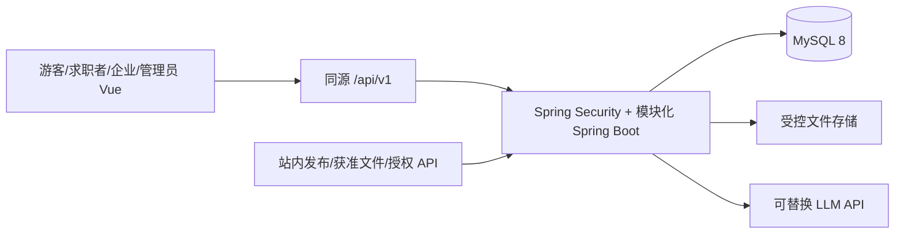

# 智能职位推荐系统开发实施工程文档

> 版本：实施草案 1.0，2026-11-01。适用目录：`毕设主项目/`。本文是待开发任务说明，不表示其中的类、表、接口或测试已经存在。阶段完成以运行和验收证据为准，不以文件写完为准。

## 0. 怎么使用本文

先按 S0→S1→S2 完成一条“获准样本/站内发布→统一职位→查询→确认画像样本→规则评分→推荐响应”的纵向链路，再推进 S3、S4；S3 与 S4 可在共同契约稳定后交错开发。每个任务执行时先读本节的完成标准，再创建对应文件，最后留下接口响应、测试结果和问题记录。路径以 `毕设主项目/` 为根，以下出现的工程路径、类名和 SQL 文件**全部标记为【待创建】**，除非明确写为“现有”。不要把示例数据、假 URL、模拟行为写成真实招聘数据。

### 0.1 依据与优先级

1. 正式任务书 `source_md/*毕业设计任务书.md` 决定必须交付三角色、用户管理、画像与行为数据推荐、收藏、站内投递、面试邀请、统计、测试和部署。
2. `docs/总体开发实施蓝图_V2.md` 是当前架构、数据契约和 S0—S6 顺序的主要基线；`docs/thesis_design_v2.docx` 是产品方案依据。跨模块契约如需变化，应同步改蓝图、迁移、接口样例和测试，不能只改某个模块。
3. `source_md/*开题报告书.md` 与 `*论文综述.md` 提供研究路线：先内容匹配、后行为优化，协同过滤以数据条件为前提；实验结论必须有样本和指标。
4. `docs/参考项目技术研究报告.md` 已完成五仓库研究；只在实现某个功能时定向看报告指定源码，参考思想与字段，不直接复制第三方代码。

### 0.2 当前真实状态与资源

2026-11-01 静态核查：`毕设主项目/` 是**空目录**，没有 `pom.xml`、`package.json`、Java/Vue 源码、配置、迁移或测试；没有可声称“已实现”的业务功能。`docs/` 现有 V2 蓝图、研究报告、V2 DOCX；正式任务书、开题报告、综述的 Markdown 位于 `source_md/`。`毕设项目参考/` 下确有 zhipin-shield、job-crawler、ZhaopinData、JobCrawlerSystem、RoleFit 五个仓库；报告所列关键源码路径已抽样核对存在。本次没有运行它们，也没有测试外部 API、LLM 或真实职位来源。

`E:/Workspace` 有通用工作台规则，但其 `01_项目/` 当前没有本毕设项目目录；本次交付按用户指定写入当前工作区 `docs/`，不借此创建或迁移另一个项目。当前工作区 Git 状态显示 `docs/` 等目录未跟踪；后续初始化主项目时先明确版本管理边界，避免把参考仓库或本地依赖目录一并提交。

### 0.3 架构与边界

`frontend`：Vue 3、Vue Router、Pinia、Axios、Element Plus。`backend`：Java 17、Spring Boot 3、Spring Security、Spring Data JPA、Flyway。`MySQL 8` 为唯一业务数据库。一个 Spring Boot 进程，以 `auth/company/job/ingestion/task/resume/profile/skill/recommendation/application/admin/common` 分包；外部来源和 LLM 用可替换接口适配。开发用 Vite 同源代理，部署用同源 HTTPS 反向代理。认证使用服务端 Session + HttpOnly Cookie + CSRF；浏览器脚本不持有长期认证令牌。简历文件在受控非静态目录，数据库保存标识与元数据。第一版不引入 Redis、消息队列、向量库、微服务或复杂 Agent。



## 1. 先懂业务流程和角色

| 角色 | 可做的事 | 必须拦截 |
|---|---|---|
| 游客 | 查有效公开职位及来源、查看详情 | 查看简历、投递、企业后台、管理后台 |
| 求职者 `SEEKER` | 管理自己的简历/画像、收藏、查看推荐、站内投递、回复面试、手填站外进度 | 处理他人投递、读取他人简历、直接向外部职位创建站内申请 |
| 企业 `COMPANY` | 管理归属企业与职位、查看本企业职位的申请及授权简历、处理面试 | 审核自己的职位、处理他企数据、查看未投递用户简历 |
| 管理员 `ADMIN` | 用户增查改、禁用恢复、企业/职位审核、来源与任务、统计 | 在无业务理由时绕开审计；系统不公开管理员创建入口 |

站内链路：企业注册/资料待审→企业获准→职位草稿→提交审核→管理员批准→公开查询→求职者投递→企业筛选→邀请面试→求职者回复→企业记录结果。站外链路：获准来源导入→标识来源和核验时间→求职者跳转原站→本人手动登记进度；本站不宣称知道站外实际投递结果。推荐链路：简历上传/手填→抽取与 LLM 草稿→人工确认画像→候选过滤→六维规则评分→证据/差距/快照→行为重排与离线对比。

## 2. 基础术语，在本项目里怎么用

| 术语（类型） | 在本项目中的具体职责与常见面试追问 |
|---|---|
| REST API（HTTP 接口风格） | Vue 用 `GET /api/v1/jobs` 请求数据，Spring 返回 JSON；问：GET/POST、状态码、幂等是什么？ |
| Controller（入口类） | `JobController` 接收查询参数、校验格式、调用 Service；不写去重和评分。问：为什么 Controller 不直接访问数据库？ |
| Service（业务服务类） | `ApplicationService.submit` 校验职位状态与归属并提交事务。问：业务规则、事务边界放哪里？ |
| Repository（数据访问接口） | `JobRepository` 用 JPA 查询职位，复杂候选筛选写显式 SQL。问：JPA 与原生 SQL 如何选择、N+1 如何避免？ |
| Entity（持久化对象） | `Job` 映射 `job` 表；不直接作为公开 API 返回，防止暴露字段/懒加载。问：Entity 与 DTO 有何区别？ |
| DTO（传输对象） | `JobDetailResponse` 只返回页面需要的已审核字段。问：为何请求/响应不直接共用 Entity？ |
| 依赖注入（Spring 对象装配） | `JobController` 通过构造器接收 `JobCatalogService`，便于换实现和测试。问：构造器注入与手动 `new` 的差别？ |
| 事务（数据库原子操作） | `submit` 同时保存投递和事件；失败时一起回滚。问：唯一约束、并发与事务分别解决什么？ |
| Flyway（迁移工具） | `V1__...sql` 记录表结构变更，干净库可重建。问：为什么不能只依赖 `ddl-auto=update`？ |
| Session/CSRF（认证状态/跨站请求保护） | 登录后服务端记身份，浏览器带 HttpOnly Cookie；写请求携带 CSRF token。问：Cookie 自动发送带来什么风险？ |

## 3. 待创建的完整工程目录与职责

下面是目标结构，**不是当前目录清单**。`api/application/domain/infrastructure` 分层只在模块变复杂时建立，避免空包。类按唯一职责拆分，后续同职责不要再造第二套 `Job`、`Skill`、评分 DTO。

```text
毕设主项目/                            # 现有空目录
├─ README.md                         # 【待创建】启动、环境和演示说明
├─ contracts/                        # 【待创建】JSON Schema、枚举、样本、接口样例
│  ├─ job-v1.schema.json
│  ├─ seeker-profile-v1.schema.json
│  ├─ job-profile-v1.schema.json
│  ├─ match-result-v1.schema.json
│  ├─ state-transitions.md
│  └─ samples/                       # 脱敏/模拟样本标注来源
├─ backend/                          # 【待创建】单一 Maven 工程
│  ├─ pom.xml
│  ├─ src/main/java/com/yhs/jobrec/
│  │  ├─ JobRecApplication.java
│  │  ├─ common/{api,security,storage}/
│  │  ├─ auth/{api,application,domain,infrastructure}/
│  │  ├─ company/{api,application,domain,infrastructure}/
│  │  ├─ job/{api,application,domain,infrastructure}/
│  │  ├─ ingestion/{api,application,domain,infrastructure}/
│  │  ├─ task/{api,application,domain,infrastructure}/
│  │  ├─ skill/{application,domain,infrastructure}/
│  │  ├─ resume/{api,application,domain,infrastructure}/
│  │  ├─ profile/{api,application,domain,infrastructure}/
│  │  ├─ recommendation/{api,application,domain,infrastructure}/
│  │  ├─ application/{api,application,domain,infrastructure}/
│  │  └─ admin/{api,application}/
│  ├─ src/main/resources/{application.yml,application-local.yml,db/migration/}
│  └─ src/test/java/com/yhs/jobrec/  # 按模块放单元/集成/权限测试
└─ frontend/                         # 【待创建】Vite + Vue 3 工程
   ├─ package.json
   ├─ vite.config.ts
   └─ src/
      ├─ main.ts
      ├─ router/index.ts
      ├─ stores/auth.ts
      ├─ api/{http,auth,jobs,imports,resumes,profiles,recommendations,applications,admin}.ts
      ├─ types/{job,profile,recommendation,application}.ts
      ├─ components/{JobCard,ScoreBreakdown,SourceBadge,StateTimeline}.vue
      └─ views/{public,seeker,company,admin}/*.vue
```

`application.yml` 只放非密钥默认值和配置键；本地密码、LLM key、API 凭据用环境变量，不提交。`spring.jpa.hibernate.ddl-auto=validate`，结构只由 Flyway 管。文件路径、数据授权证明和样本哈希记录在受控开发资料，个人简历原文不进 Git。

## 4. S0 必须冻结的数据契约

### 4.1 统一职位 `JobV1`

`job` 是规范业务职位，`job_source_record` 是某个来源的稳定身份，`raw_job_record` 是某次获取的不可变原始证据；一个 `job` 可有多个来源记录，一个来源记录可积累多次原始快照。内部职位也有 `INTERNAL` 来源标识，但企业发布通过审核命令进入 `job`，不走外部采集 Worker。

| `JobV1` 字段/类型建议 | 语义、空值与规则 |
|---|---|
| `id: long`, `version: long` | 本站身份和乐观锁；来源 ID 不能替代 `job.id` |
| `companyId: long?`, `companyNameSnapshot: string` | 内部职位必须有经审核归属；外部只用名称快照，不冒认本站企业 |
| `title: string`, `directionCode: string?` | 职位名原样显示；方向按字典，如 `JAVA_BACKEND`，未知为 `UNKNOWN` |
| `jobType: enum`, `workMode: enum` | `INTERNSHIP/FULL_TIME/PART_TIME/UNKNOWN` 与 `ONSITE/REMOTE/HYBRID/UNKNOWN`；硬筛选用码值 |
| `cityRaw: string?`, `cityCode: string?`, `district: string?` | 原文与行政区划代码并存；无法可靠映射时 `cityCode=null` |
| `salaryRaw`, `salaryPeriod`, `salaryMonths`, `salaryMinMonthly`, `salaryMaxMonthly` | 原文、`MONTH/YEAR/DAY/HOUR/NEGOTIABLE/UNKNOWN`、薪数和人民币月薪等价区间；无可靠工作天数的日薪不换算，面议为 null |
| `educationMin: enum`, `experienceMinMonths/maxMonths: int?` | 未写要求用 `UNKNOWN/null`，不等于 0 年或无门槛 |
| `description: text`, `status: enum` | JD 原文受控；内部 `DRAFT/PENDING_REVIEW/OPEN/PAUSED/CLOSED/EXPIRED/REJECTED`，外部可见性还取决于来源状态 |
| `publishAt`, `expireAt`, `lastVerifiedAt` | ISO 时间含时区；查询时重新检查截止时间与 TTL |
| `applicationMode: INTERNAL/EXTERNAL` | 派生展示字段；内部可站内投递，外部仅跳转与手动记录 |

接口采用 camelCase，SQL 采用 snake_case。枚举和时间单位在 `contracts/` 固定；数据库用可索引的列保存参与过滤的字段，不把整个职位只塞进 JSON。`JobV1` 示例中的日薪 `150-200元/天` 应保持月薪区间 null，不能虚构 30 天换算。

### 4.2 画像、评分和任务契约

`SeekerProfileV1`：`userId/profileVersion/confirmedAt/targetDirections/jobTypes/workModes/expectedCityCodes/expectedSalaryMinMonthly/educationLevel/experienceMonths/skills[{skillId,level 1..4,evidenceRef}]`。用户未填写的字段保持 null/空列表，空列表不自动解释为“接受所有”。`JobProfileV1`：`jobId/jobVersion/profileVersion/directionCode/jobType/workMode/educationMin/experienceMinMonths/requiredSkills/preferredSkills/evidenceRefs`。`ResumeParseDraftV1` 只存模型建议的 `rawName`、证据、缺失字段、schema/model/prompt 版本；技能 ID 需 `SkillResolver` 对齐，用户确认后才写正式画像。

`MatchInputV1` 固定求职画像版本、岗位画像版本、职位版本、算法版本；`MatchResultV1` 固定 `totalScore/evidenceCoverage/dimensionScores/matched/unmet/unknown/skillGaps/evidenceRefs/reasonCodes`。`MatchScorer` 是无数据库、无 LLM 的纯 Java 计算。来源不可改变匹配分；分差 ≤3 的已审核内部岗位优先只是并列排序规则，并返回 `displayPriorityReason`。

导入契约：`JobSourceProvider.fetch(FetchRequest{sourceCode,cursor,pageSize,keyword?,city?,taskId}) → RawJobBatch{records,nextCursor,complete}`。原始行包含稳定 `externalKey` 或 `originalUrl`、来源、获取时间和 payload。`JobIngestionService.ingest` 返回 `ACCEPTED/UPDATED/REJECTED/REVIEW_REQUIRED`、`jobId?` 与错误码。任务有 `PENDING/RUNNING/PAUSE_REQUESTED/PAUSED/CANCEL_REQUESTED/SUCCESS/PARTIAL_FAILED/FAILED/CANCELLED`；暂停/取消为**边界点协作处理**，不是强杀线程。恢复必须持久化游标与租约。

### 4.3 关键表、索引与迁移顺序

以下表名均【待创建】，字段为实现最低集；迁移时补 `created_at/updated_at` 等审计列及 FK。避免把多表一次写成无法验证的大脚本。

| 迁移（待创建） | 表和关键列/约束 | 立即验证 |
|---|---|---|
| `V1__identity_company_job.sql` | `user(id,login,password_hash,status,version)`；`user_role(user_id,role)` 唯一；`company(id,owner_user_id,review_status,version)`；`job(id,company_id?,title,...,status,version)`；`job_source(id,code,kind,authorization_note,enabled,ttl_hours)`；`job_source_record(id,source_id,external_key,job_id?,source_status,last_seen_at,last_verified_at)`，`(source_id,external_key)` 唯一；`review_event` 留审核轨迹 | 空库迁移成功；内部职位归属非空；重复来源键受阻 |
| `V2__import_skill.sql` | `job_import_task(id,source_id,idempotency_key,status,cursor,lease_owner,lease_until,heartbeat_at,counters...)` 唯一幂等键；`job_import_log`；`raw_job_record(task_id,row_key,payload,content_hash,validation_errors,source_record_id?)` 唯一 `(task_id,row_key)`；此时再给 `job_source_record` 增加 `latest_raw_id` FK，避免 V1 引用尚未创建的表；`skill`、`skill_alias` 唯一规范名/别名 | 重复任务键回原任务；重复行不插两份；原始失败行可查 |
| `V3__recruitment.sql` | `resume` 元数据；`favorite(user_id,job_id)` 唯一；`application(seeker_user_id,job_id,resume_id,status,version)` 唯一；`application_event`；`interview_invitation`；`external_application_record(seeker_user_id,job_id)` 唯一；`user_job_behavior` | 重复投递受约束；事件与申请关联；外部记录不能作为内部申请 |
| `V4__profiles_recommendation.sql` | `resume_parse_task/result`；`seeker_profile(user_id,version,confirmed_at,...)` 唯一；`seeker_skill(profile_id,skill_id)` 唯一；`job_profile(job_id,profile_version,job_version,...)`；`job_skill`；`recommendation_run`；`recommendation_item(run_id,job_id)` 唯一 | 草稿与确认画像分离；旧评分可按版本重现 |
| `V5__evaluation_quality.sql` | `evaluation_case/evaluation_result`（独立离线标注集）；必要的来源质量和审计查询索引，不把模拟标注混进真实行为 | 同一评估集重算指标一致；能区分数据来源 |

必要索引：`job(status,job_type,city_code,expire_at)`、`job(direction_code,status)`、`job(company_id,status)`、`job_source_record(job_id,source_status)`、`job_import_task(source_id,status,created_at)`、`application(job_id,status)`、`application(seeker_user_id,status)`、`user_job_behavior(user_id,occurred_at)`、`recommendation_run(user_id,created_at)`。先用实际查询和 `EXPLAIN` 验证，再增索引；若 JPA 查询生成低效 SQL，用显式 Repository SQL 并测试分页稳定性。

## 5. S0—S6 执行顺序总览

| 阶段 | 严格前置与可交错工作 | 必须留下的通过证据 |
|---|---|---|
| S0 契约与样本 | 无；页面字段草图和权限矩阵可并行 | JSON 样例、状态表、获准来源登记、5—10 行边界样本、字段映射评审 |
| S1 工程与站内职位 | S0；前端页面与后端可按契约并行 | 空库重建、登录/权限、企业提交→管理员审→游客查的浏览器和接口证据 |
| S2 导入与最小推荐链 | S1；词典与文件解析可并行 | 导入两次无重复职位，坏行可查，确认画像样本→六维评分→前端调试页 |
| S3 招聘业务 | S1 授权和职位状态；可与 S4 交错 | 收藏→站内投递→企业处理→面试回复，越权/重复/关闭职位测试 |
| S4 AI/画像/正式推荐 | S2 契约与最小评分；与 S3 交错 | PDF/DOCX→草稿→手改确认→不同用户不同排序；模型失败可手填 |
| S5 联调与部署 | S3+S4 核心能力 | 端到端演示、权限矩阵、性能/恢复记录、统计、干净环境部署 |
| S6 行为与论文验收 | S3 行为记录、S5 稳定版 | 行为重排开关与实验、独立标注集、指标重现、论文/视频/源代码清单 |

**强制早期联调门槛**：S2 结束前，浏览器或可见调试页必须走通“导入样本→管理员见任务→职位列表→确认画像样本→推荐分项证据”。任何模块只通过单元测试而这条链断开，不能算 S2 完成。

## 6. 分阶段任务卡：创建什么、实现什么、怎么验收

每张任务卡中的路径均【待创建】。实施时先建失败样例与接口响应样例，再做最小代码；测试数据必须标注 `SIMULATED`、`INTERNAL` 或真实来源及授权记录。记录“执行命令、环境、样本、响应/截图、是否通过”，便于毕业论文引用真实证据。

### S0 契约、字典和样本

**S0.1 权限与状态契约。** 在 `contracts/state-transitions.md` 写三角色权限矩阵、公司审核状态、职位状态、申请状态、任务状态的合法转移和操作者；在 `contracts/api-examples/` 放成功和错误 JSON。`JobV1` 与用户确认画像是后续所有模块的共同语言。为什么：前后端与多个后端模块若各自定义状态，会出现“页面能点但后端拒绝”或越权。验收：逐行检查任务书八项要求有去处；用角色 A/B 和企业 A/B 各写一个越权案例，状态图能明确判定；未知/空值定义无歧义。

**S0.2 字段和字典。** 创建前述 4 份 JSON Schema、`contracts/enums.md`、`contracts/salary-normalization.md`、`contracts/city-normalization.md`。固定职位方向、工作类型、工作方式、学历顺序、技能等级 1—4、薪资单位、时间时区；将 `SpringBoot/Spring Boot` 映射到同一标准技能 ID 的**规则与样例**写清。薪资无法可靠换算就留 null；城市只在能够确定时写标准码。为什么：0 与未知、模拟月薪与真实薪资混淆会污染推荐。验收：至少 10 例字段映射，覆盖面议、日薪、13 薪、多城市、学历未写、经验未写、缺链接。

**S0.3 来源与脱敏样本。** `contracts/samples/` 中准备 5—10 行获准文件样本；每行含来源码、稳定平台 ID 或原 URL、职位原文、获取时间。另存来源登记：来源方、许可范围、获取途径、展示限制、核验日期、文件 SHA-256。若授权材料尚无，先用明确标注的模拟样本完成代码验证；“真实样本验收”保留未通过。另准备 2 个相反意向的脱敏求职画像、同来源重发、跨来源疑似同岗、同名异城、已过期及缺必要字段案例。验收：样本能支撑 S1/S2 集成测试，每个来源有可追踪证据。

**本阶段需要掌握的知识。** Schema 是数据形状约束，字典是有限取值约束；数据库设计先确定身份、状态和空值语义。企业后端项目常先冻结接口与状态以减少返工。面试自问：“为何职位来源 ID 不能做全局职位 ID？为什么未知学历不能当作无限制？”

### S1 可运行工程、认证、企业职位与审核

**S1.1 工程骨架。** 创建 `backend/pom.xml`（Web、Validation、Security、Data JPA、MySQL Driver、Flyway、Test）及 `JobRecApplication.java`、`application.yml`；创建 `frontend/package.json`、`vite.config.ts`、`src/main.ts`、`router/index.ts`、`api/http.ts`。`api/http.ts` 统一 `/api/v1`、请求 ID、错误结构和 CSRF header；Vite 代理 API。先实现 `GET /api/v1/health`，前端首页调用它。验收：Java 17、MySQL 8、Node 版本记录；空库 Flyway 成功；后端和前端独立启动、代理返回健康状态；断库时启动失败而非静默建假库。Spring Boot 负责装配对象，Vue 组件负责视图，不让页面保存业务真值。

**S1.2 认证与对象权限。** 创建 `auth/domain/User.java,UserRole.java`、`auth/infrastructure/UserRepository.java,UserRoleRepository.java`、`auth/application/AuthService.java`、`auth/api/AuthController.java`、`common/security/SecurityConfig.java,CurrentActor.java`、`common/api/ApiExceptionHandler.java`。`AuthService.registerSeeker(email,password)` 校验唯一登录名、哈希密码、默认仅 SEEKER；企业注册创建待审企业关联；`login` 交由 Spring Security 会话流程，`logout` 失效 Session；`CurrentActor.requireRole(role)` 提供已认证身份，具体归属由各业务 Service 查询职位/企业/简历后复核。`AuthController` 提供 `/auth/register`、`/auth/login`、`/auth/logout`、`/auth/me`（具体登录过滤器与端点方式在 S0 接口样例固定）。禁止公开管理员注册。前端 `stores/auth.ts` 保存从 `/auth/me` 获取的用户摘要，不在 localStorage 存认证凭证；`router/index.ts` 做用户体验级路由守卫，后端仍是权限最终裁决。验收：未登录 401、错误角色 403、A 企业不能改 B 企业职位；登录后 Cookie 为 HttpOnly，写请求缺 CSRF 被拒，重新登录与退出行为正确。这里要理解“角色校验”与“记录归属校验”是两件事。

**S1.3 企业与统一职位。** 创建 `company/domain/Company.java`、`company/infrastructure/CompanyRepository.java`、`company/application/CompanyService.java`、`company/api/CompanyController.java`；`job/domain/Job.java,JobSource.java,JobSourceRecord.java,JobDraftV1.java`、对应 `infrastructure/*Repository.java`、`job/application/CompanyJobService.java,JobCatalogService.java,JobVisibilityPolicy.java`、`job/api/JobController.java,CompanyJobController.java`。`CompanyJobService.createDraft(actor,draft)` 检查企业归属与资料状态，保存 `DRAFT`；`updateDraft(id,expectedVersion,patch)` 仅允许有权人改可编辑状态；`submitReview(id,expectedVersion)` 验证必填并转 `PENDING_REVIEW`。`JobCatalogService.approve/reject` 由管理员调用，写审核人、时间、原因、版本；`JobVisibilityPolicy.isPublic(job,now)` 统一处理审核、关闭、到期及来源有效性。`JobController.list/get` 只返回 DTO，不返回 Entity、简历或内部备注。前端建 `views/company/JobEditor.vue,MyJobs.vue`、`views/public/JobList.vue,JobDetail.vue`、`components/SourceBadge.vue`。验收：企业职位经管理员审核后才可公开，关闭后马上从搜索消失；更新版本冲突返回 409；企业 B 更新企业 A 职位 403；分页排序稳定。发布与审核分别是业务事务，不能由前端提交 `status=OPEN` 绕过审核。

**S1.4 管理员审核与用户基础管理。** 创建 `admin/api/ReviewController.java`、`admin/application/ReviewService.java`，调用公司/职位模块服务而非直接跨包改表；记录审核事件。此时先做审核，完整用户管理在 S3 扩展。前端 `views/admin/ReviewQueue.vue` 显示待审企业/职位、详情及拒绝理由。验收：管理员批准与拒绝均可追溯；重复点击带版本号时不会重复变更；非管理员 403。S1.3 的职位页与此任务可按契约并行写，但最终链路必须联调。

**本阶段需要掌握的知识。** Controller 接 HTTP，DTO 控制输入输出，Service 执行业务，Entity/Repository 管持久化；构造器注入让它们可测试。事务用于“状态+审核事件”同时成功或失败。企业常问：“为什么 URL 中的 companyId 不能作为归属证明？为什么唯一索引仍需要业务校验？”

### S2 文件导入、数据中心与最小推荐链

**S2.1 来源配置与任务创建。** 创建 `ingestion/domain/JobSourceProvider.java,FetchRequest.java,RawJobBatch.java`、`ingestion/infrastructure/FileJobSourceProvider.java`；`task/domain/JobImportTask.java,JobImportLog.java`、`task/infrastructure/*Repository.java`、`task/application/JobImportService.java`、`task/api/ImportTaskController.java`。`createTask(actor,sourceId,fileId?,trigger,idempotencyKey)` 查来源 `enabled/授权说明`、文件 MIME/大小、活动任务冲突，持久化 PENDING 并返回 202 `{taskId,status}`；同幂等键和同参数返回原 task，不同参数复用键返回 409。文件先保存至受控目录，用文件哈希关联任务；支持 CSV UTF-8 与 Excel XLSX，解析 Excel 用 POI。API Provider 只在来源真正授权且凭据就绪时启用，`RestClient` 显式设置连接/读取超时和限速，不直接写 `job`。前端 `views/admin/ImportTasks.vue` 创建任务、轮询状态、看行级错误。验收：同键连点只建一个任务；无授权来源 409/422；错误文件类型/超限 400/413；任务立即返回而不等完整文件。

**S2.2 原始快照、映射和清洗。** 创建 `ingestion/domain/RawJobRecord.java,NormalizedJobDraft.java,RowOutcome.java`、`ingestion/application/JobFieldMapper.java,JobNormalizer.java,JobValidator.java,SalaryNormalizer.java,CityNormalizer.java`、`ingestion/infrastructure/RawJobRecordRepository.java`。`FileJobSourceProvider.fetch` 按页/行返回 payload 和稳定 rowKey；`JobFieldMapper.map(raw,sourceMappingVersion)` 把来源字段变成统一草稿；`JobNormalizer.normalize` 保留原文同时规范薪资、城市、工作类型、学历、经验；`JobValidator.validate` 输出字段级错误码，不因一行坏数据让整批回滚。先落 `raw_job_record` 再执行转换，日志保留错误码。验收：面议、无法换算的日薪、空城市、13 薪、多薪、含 HTML/特殊字符样例逐项有预期；失败原始行可查；重新运行相同行不制造额外来源职位。不可把“没抓到”写成职位关闭。

**S2.3 精确去重与疑似重复。** 创建 `ingestion/application/JobDeduplicator.java,JobIngestionService.java,JobMergeReviewService.java`。`JobDeduplicator.findSameSource(sourceId,externalKey)` 用唯一键精确查；键优先平台 ID，其次规范化稳定 URL，没有则 `REVIEW_REQUIRED`，不能靠公司+标题自动更新。`findCrossSourceCandidates` 查询规范企业名、标题、城市、类型、JD 特征；只生成候选及证据分，**不加内容哈希唯一约束**。管理员确认或高置信且企业身份明确时，多个来源记录可指向一个 `job`；不确定就保留两条并标疑似。`JobIngestionService.ingest(taskId,rawId)` 在逐行事务中保存/更新 `job_source_record` 与 `job`，空值不覆盖已审核且非空的高质量字段，职位变化递增 `job.version` 并触发岗位画像待更新。唯一键冲突后重新读取记录并走幂等更新，不靠“先查后插”防并发。验收：同来源重复导入来源记录数不变；跨来源同岗需复核时不误合并；同名异城保持两个职位；来源原 URL 和历史快照都保留。

**S2.4 任务可靠性和有效性。** 创建 `task/application/ImportTaskWorker.java,ImportTaskScheduler.java,TaskLeaseService.java`、`job/application/JobFreshnessService.java`。`claimNext(workerId,now)` 在数据库条件更新下领取到期/待执行任务，确保同来源仅一个活动租约；每批完成提交 cursor、计数和心跳，长批执行中定期检查 `PAUSE_REQUESTED/CANCEL_REQUESTED`。重启后租约到期再领取；`(task_id,row_key)` 与来源键防重复，日志记录异常分类。只重试超时、429、5xx，指数退避有上限；401/403、字段契约错误不可盲重试。`JobFreshnessService` 对明确关闭立即下架、`expireAt` 到期直接排除、超过来源 TTL 标 `STALE`；一次不完整或失败扫描不批量关停“未见”职位。终态有拒绝行即 `PARTIAL_FAILED`；管理员可查拒绝原因并重试修正后的新任务。验收：启动后中断任务再恢复无重复；暂停/取消在批边界生效且计数不丢；429 延迟重试、403 失败；部分坏行不报 SUCCESS；过期/STALE 不进入推荐。

**S2.5 技能词典与最小推荐纵向验证。** 创建 `skill/domain/Skill.java,SkillAlias.java`、`skill/application/SkillResolver.java`、`recommendation/domain/MatchInputV1.java,MatchResultV1.java`、`recommendation/application/MatchScorer.java` 的第一版、`recommendation/api/RecommendationController.java`、`frontend/src/views/seeker/RecommendationDebug.vue`。词典先种 Java/Spring Boot/MySQL 等经人工核准的少量技能，`resolve(rawName,category)` 返回标准 ID 或待审核，不让 AI 生造 ID。用 S0 人工确认的**脱敏画像 JSON 测试夹具**和 S2 获准/模拟职位，查询有效候选、计算六维分、返回 DTO；调试页必须展示来源标签、分项、未知项和证据。调试入口仅本地开发/测试环境开放，不接收任意用户画像用于生产推荐；S4 建正式画像表与推荐快照后切换到 `/recommendations` 正式接口，但响应形状保持一致。验收：两个不同画像排序不同；同输入同算法版本重算同分；过期职位不见；至少一例未知薪资的分数与覆盖率正确；前后端都跑通。

**本阶段需要掌握的知识。** 数据清洗是将来源文本变成业务可比较字段；幂等表示同一请求重复执行不造成重复业务效果；租约是 Worker 在限定时间内拥有任务处理权，心跳表示仍在工作。企业 Java 常用数据库唯一约束、批处理、可恢复游标做可靠导入。面试自问：“服务在写入一半时崩溃，如何继续？为什么一次扫描失败不能把职位全关掉？”

### S3 收藏、投递、面试、用户和行为闭环

**S3.1 收藏与行为采集。** 创建 `application/domain/Favorite.java,UserJobBehavior.java`（也可在 `favorite` 子包，但全工程选一处）、`application/application/FavoriteService.java,BehaviorService.java`、对应 Repository 与 Controller；前端 `views/seeker/Favorites.vue`。`FavoriteService.add/remove(userId,jobId)` 查当前职位可见性，唯一键使重复收藏无多条记录；取消收藏返回可预期结果。`BehaviorService.record(userId,jobId,eventType,occurredAt,requestId)` 记录浏览、收藏、投递、负反馈；浏览可采样或按会话去重，防刷新刷量，敏感细节最小化。不能把前端上报的任意用户 ID 当真。验收：A 的收藏 B 不可见；重复收藏无重复；取消再收藏正确；行为类型和时间可查，模拟行为有标识。

**S3.2 站内投递与企业处理。** 创建 `application/domain/Application.java,ApplicationEvent.java,ApplicationState.java`、`application/infrastructure/ApplicationRepository.java,ApplicationEventRepository.java`、`application/application/ApplicationService.java,ApplicationStateMachine.java`、`application/api/ApplicationController.java`；前端 `views/seeker/MyApplications.vue`、`views/company/Applications.vue`、`components/StateTimeline.vue`。`submit(actor,jobId,resumeId,requestId)` 在事务中重新查职位为内部、已审核、OPEN、未过期、归属企业可用，简历属于求职者，保存申请和首事件；唯一 `(seeker_user_id,job_id)` 防并发重复，返回现有结果或 409 按 S0 契约固定。`transition(actor,id,expectedState,targetState,expectedVersion,reason)` 校验状态表、企业归属/求职者本人及版本，保存状态和事件。企业查询只显示其职位收到的申请和必要简历字段；求职者只见自己的。验收：正常从 `SUBMITTED→SCREENING→REJECTED`，或 `SCREENING→INTERVIEW_INVITED`；关闭职位、外部职位、他人简历、重复投递及并发状态修改均拒绝；事件时间线完整。若暂未有 S4 正式上传，可在 S3 先用受控简历元数据和脱敏样例打通链路，不伪称 AI 解析已完成。

**S3.3 面试邀请与回复。** 创建 `application/domain/InterviewInvitation.java`、`application/application/InterviewService.java`、`application/api/InterviewController.java`；前端 `views/company/InterviewEditor.vue`、`views/seeker/InterviewInbox.vue`。`invite(actor,applicationId,time,mode,placeOrLink,expectedVersion)` 仅在合法申请状态、企业归属正确时创建邀请并写事件；`respond(actor,invitationId,ACCEPT/DECLINE,expectedVersion)` 仅求职者本人可答，事务写回复与申请新状态。时区、过去时间、重复邀请与过期邀请要校验；撤回邀请留事件，不能硬删历史。验收：企业 A 不能邀 B 的申请，求职者 B 不能答 A 的邀请；双击回复只生效一次；企业和求职者看到同一时间线。

**S3.4 站外手动记录、管理员用户管理与统计骨架。** 创建 `application/domain/ExternalApplicationRecord.java`、`application/application/ExternalApplicationService.java`、`application/api/ExternalApplicationController.java`；`admin/application/UserAdminService.java,StatsService.java`、`admin/api/UserAdminController.java,StatsController.java`；前端 `views/seeker/ExternalApplications.vue`、`views/admin/Users.vue,Dashboard.vue`。站外记录接口仅允许本人为 `EXTERNAL` 职位增改 `NOTED/APPLIED_BY_USER/IN_PROGRESS/CLOSED_BY_USER` 等**自述状态**；本站不自动生成外部申请。`UserAdminService.create/query/update/disable/restore` 做角色校验、登录名唯一、密码重置受控、禁用后现有 Session 失效或每次请求复核状态；操作留审计。`StatsService` 按角色和状态统计用户、企业、职位、投递、基础推荐调用数，写清统计口径与时间范围，不能把点击当作录用。验收：管理员五项用户操作可演示；禁用用户下一请求不可访问；统计与 SQL 人工核对一致；站外记录只本人可看改。

**本阶段需要掌握的知识。** 状态机是“当前状态+动作+操作者→是否允许的新状态”的规则表；数据库唯一键保护并发，事务保护申请与事件一起提交。企业后端面试常问：“如何防重复投递？如何阻止企业查看其他企业的简历？状态改错怎样保留审计？”

### S4 PDF/DOCX、双侧画像和正式推荐

**S4.1 简历文件和文本提取。** 创建 `resume/domain/Resume.java,ResumeParseTask.java,ResumeParseResult.java`、`resume/application/ResumeFileService.java,ResumeTextExtractor.java,ResumeParseTaskService.java`、`resume/infrastructure/PdfTextExtractor.java,DocxTextExtractor.java,PrivateFileStore.java`、`resume/api/ResumeController.java,ResumeParseTaskController.java`；前端 `views/seeker/Resumes.vue`。`upload(actor,file)` 限 PDF/DOCX、大小、真实文件签名和用户配额，随机存储 ID、防路径穿越，保存 MIME、哈希、大小与属主；文件不在 Web 静态目录。`extract(resumeId)` PDF 用 PDFBox 等兼容库、DOCX 用 POI，控制页数/文本长度/超时；扫描版无文字明确返回 `TEXT_UNAVAILABLE`，第一版不谎称支持 OCR；若要加入 OCR，先记录依赖和样本验证。`.doc` 未验证解析器时明确拒绝。下载和解析端点每次查属主/企业已授权投递关系。验收：正常 PDF/DOCX 得非空文本；空白扫描 PDF、伪装扩展名、超限文件、恶意路径和 A 读 B 文件均得到明确错误；文件无公网直链。

**S4.2 可替换 LLM 解析与失败回退。** 创建 `resume/application/ResumeParser.java,ResumeParseWorker.java,ResumeSchemaValidator.java`、`resume/infrastructure/LlmResumeParser.java,ManualResumeParser.java` 与受控 JSON Schema；配置 `model/prompt/schema` 版本。Worker 从任务表领取、限并发、超时与重试，向模型发送必要且脱敏的文本和严格输出 Schema；将返回 JSON 做语法、枚举、数值范围、证据引用和长度校验，拒绝模型输出的自造 `skillId`、匹配分、未经证据支持的经历。保存不可覆盖的 `resume_parse_result` 草稿及失败分类，不直接改正式画像；模型不可用时求职者可手填。提示注入文本视为数据，不执行其中命令。记录调用耗时、成本与失败率，日志不写完整简历或密钥。验收：10—20 份脱敏样本人工核对字段准确率/技能对齐率；模型超时、非 JSON、越界等级、虚构证据、重复任务、服务重启均有确定结果和手填入口；外部模型数据保留政策核实并记录。

**S4.3 用户确认画像与版本。** 创建 `profile/domain/SeekerProfile.java,SeekerSkill.java,SeekerProfileV1.java`、`profile/infrastructure/*Repository.java`、`profile/application/SeekerProfileService.java`、`profile/api/ProfileController.java`、`skill/application/SkillResolver.java`；前端 `views/seeker/ProfileReview.vue,ProfileEditor.vue`。`previewDraft(userId,draftId)` 只返回本人草稿及原文证据；`confirm(userId,draftId?,editedProfile,expectedVersion)` 校验城市/薪资/等级/标准技能 ID，未对齐别名列待确认项，事务写当前画像和技能、版本 +1、确认时间及变更审计；不得由新简历解析自动覆盖已确认内容。手动填写走同一确认接口。`GET /me/profile` 返回确认版，不返回其他用户简历原文。验收：同一草稿可修改后确认，未知技能不可悄悄算命中；两个并发编辑仅一个成功，另一个 409；再次解析产生新草稿但旧画像保持；删除/更换简历不破坏既有申请快照。

**S4.4 岗位画像。** 创建 `profile/domain/JobProfile.java,JobSkill.java,JobProfileV1.java`、`profile/application/JobProfileService.java,JobRequirementExtractor.java`、相应 Repository。`build(jobId,jobVersion,jdText)` 从规范职位字段和 JD 中提取方向、类型、学历、经验、必需/加分技能、等级和原文片段；词典识别与人工复核优先，AI 可辅助抽取但必须 Schema/证据校验。`(job_id,profile_version)` 保留历史，写明由哪个 `job.version` 生成；Job 更新 JD 后标画像过期并排队重建。缺岗位技能时仍可计算其他维度，但覆盖率下降。验收：职位改版后旧画像不被覆盖，推荐只用当前匹配版本；“熟悉 Spring Boot”与别名同 ID；模型误提技能可复核撤回。

**S4.5 候选、硬过滤、六维评分、理由和快照。** 创建 `recommendation/application/CandidateSelector.java,EligibilityPolicy.java,MatchScorer.java,ReasonBuilder.java,RecommendationService.java`、`recommendation/domain/AlgorithmConfigV1.java,ScoreBreakdownV1.java,RecommendationRun.java,RecommendationItem.java`、相应 Repository；前端 `views/seeker/Recommendations.vue`、`components/ScoreBreakdown.vue,JobCard.vue`。`CandidateSelector.find(profile,filters,page)` 用 Repository/明确 SQL 限定有效、授权、未过期、未投递/明确不感兴趣职位，分页有稳定排序；不把全表载入 Java。`EligibilityPolicy.check` 对明确硬条件（职位关闭、来源失效、用户明确要求的工作类型/地点/学历底线）返回排除原因；未知条件不能当作确定通过/失败，按 S0 约定标 `UNKNOWN`。`MatchScorer.score(input)` 只用六维和证据返回结果。`ReasonBuilder.format(result)` 从同一结果生成匹配项、缺口和理由码，不重算分数；可选 LLM 仅润色已存证据，失败回退规则模板。`RecommendationService.recommend` 保存 run 和每个 item 的 profile/job/算法版本、分项、证据、名次；展示前再检查职位当前有效性。验收：同版本同输入同分同理由码；无证据维度显示 unknown 和低覆盖，不能称“高度匹配”；职位关闭后旧快照可审计但列表不展示；两个用户排序不同；查询页在合理样本量下无 N+1/全表加载。

**本阶段需要掌握的知识。** PDF/DOCX 提取是文件解析，不等于 AI；Schema 校验防模型输出形状错误，人工确认决定正式业务真值；纯函数评分便于重现与实验。企业 AI 应用常问：“模型幻觉如何避免写库？推荐理由如何与分数一致？用户简历出站给模型前做什么隐私处理？”

### S5 联调、质量、统计与部署

**S5.1 每条业务链联调。** 固定 `frontend/src/api/*.ts` 请求/响应类型与后端 DTO、字段名、分页和错误码；`api/http.ts` 统一 401/403/409/422/429/5xx 与 CSRF 处理，不让每个组件自造异常逻辑。逐条跑游客查询、企业发布审批、文件导入、简历确认、推荐收藏、投递面试、管理员统计；每条留浏览器截图+接口请求/响应+数据库核对。验收：角色切换、刷新、会话过期、空列表、模型不可用、来源任务运行中均有明确页面状态；不能等所有模块开发完才首次联调（S2 已有首链）。

**S5.2 权限、异常与性能。** `backend/src/test/...` 增加 Security/Service/Repository 集成测试，覆盖“用户 A/B、企业 A/B、管理员、游客”的端点和对象归属矩阵。对所有写操作验证服务端输入、唯一键冲突、期望版本与事务回滚；上传做类型/大小/所有权检查，敏感日志脱敏。以记录的机器、数据量和工具跑职位分页、推荐和任务吞吐测试，检查 SQL 日志与 `EXPLAIN`；记录 P50/P95、失败率、样本规模和瓶颈，不能填想象数值。验收：主要越权样例全部拒绝且无数据泄露；同一请求 ID 可查异常；关键接口无明显 N+1；恢复测试无丢数。

**S5.3 统计、来源质量和部署。** `admin/application/StatsService.java,SourceQualityService.java` 按确定口径统计用户/企业/职位/投递/推荐效果调用、来源可追溯率、必要字段完整率、重复率、同步成功率、有效/STALE/过期数；展示模拟与真实来源分开。`README.md` 与 `docs/deployment.md`【待创建】记录 Java/Node/MySQL 版本、环境变量清单、Flyway、初始化管理员办法、前后端构建、同源 HTTPS 代理、受控文件目录、备份/恢复和演示账号脱敏。至少在干净数据库和独立部署环境按说明重建一次。V2 的 50 条可核验真实职位是**内部目标**，授权不足则如实报未达成，不用模拟数据冒充。验收：页面统计与 SQL 对账；新环境按文档可启动；安全 Cookie/CSRF 在部署域生效；演示视频能走完站内闭环。

**本阶段需要掌握的知识。** 联调验证模块间真实数据流；性能测试需要说明环境与样本；部署不是“本机 IDE 能运行”。企业面试常问：“接口 403/409/500 分别代表什么？如何从日志定位一条失败请求？数据库迁移失败如何处理？”

### S6 行为重排、算法对比与论文验收

**S6.1 行为特征与可开关重排。** 创建 `recommendation/application/BehaviorFeatureService.java,BehaviorReranker.java`、`recommendation/domain/BehaviorConfigV1.java`；只读取 S3 的浏览、收藏、投递、负反馈，并按时间衰减、去刷量及事件权重生成偏好特征。`rerank(baseResults,features,config)` 在基础规则分之外计算有限的行为调整，保存基础分、调整分、最终次序及 `behaviorVersion`，不得改写基础六维匹配证据；负反馈/已投递职位优先从候选排除。新用户、行为少或关闭开关时返回纯内容版；协同过滤只有真实交互量、隐私与实验条件足够时再加入。验收：同画像不同合法行为产生可解释的排序差异，关闭开关回到同一基线，模拟刷点击不无限抬分；结果快照记版本。

**S6.2 离线对比。** 创建 `evaluation/domain/EvaluationCase.java,EvaluationResult.java`、`evaluation/application/RecommendationEvaluator.java`、`contracts/samples/evaluation/`【待创建】。先独立人工标注用户—职位相关等级，锁定训练/调权样本与最终评估样本，不能拿同一集调权又宣称泛化。比较热门/最新、内容规则、内容+行为，条件允许再加职位协同过滤；记录每组样本量、数据来源、切分、算法和权重版本、Precision@K、NDCG@K、覆盖率/证据完整度及重复试验时间。`evaluation_result` 只放离线实验，不能混成真实申请或录用反馈。验收：同输入同版本重算指标一致；报告包含失败案例和局限；不使用“录用概率/录用率提高”表述基础匹配分。

**S6.3 毕设交付。** 按任务书准备源代码、设计方案、部署说明、数据库迁移、测试报告、演示视频和论文初稿；2027-03-15 前的验收/初稿是正式进度节点。逐项核对管理员用户管理、五类统计、行为参与推荐、三角色业务闭环和实际部署证据。12 月底冻结与 50/300—500 条职位数只是 V2 内部计划，不代替学校或导师要求。验收：导师可在已部署环境按脚本完成三角色演示，论文中的每个数据数字能追溯到测试记录/标注集。

**本阶段需要掌握的知识。** 冷启动是新用户缺行为数据，内容匹配能先工作；离线指标衡量在给定标注集上的排序质量，不等于商业效果。面试自问：“如何证明行为数据真正影响了排名？为什么要保存算法版本和独立评估集？”

## 7. 核心模块的执行细则

### 7.1 职位数据中心：来源、更新与失效

**写入顺序。** 文件/API Provider 读原始行→`RawJobRecord` 留证→字段映射→标准化/校验→同来源精确查→跨来源候选复核→逐行事务 upsert `JobSourceRecord` 和 `Job`→写行级结果、游标、计数→触发岗位画像重建。来源配置要记使用许可、类型、展示名、刷新周期、TTL；密钥只在环境配置，日志不能打印。站内发布由 `CompanyJobService` 校验企业/审核，不把企业用户当外部 Provider。

**字段冲突。** 内部审核字段优先；外部字段比较原文证据、更新时间与完整度，空值不覆盖非空高质量值；每次规范职位实际变化才加 `job.version`。不同来源对同一职位的状态独立：某来源失效但另一个仍获准有效，统一职位可继续展示并选择有效来源链接。若内部职位关闭，不能靠外部快照重新打开内部申请入口。管理员要能看每次字段选择的来源和差异。

**核验规则。** `OPEN` 不是永久有效：查询同时检查 `expire_at>now`、来源许可和 `last_verified_at + ttl`。明确关闭立即排除；过期直接排除；TTL 超时标 `STALE`，在 S0 约定搜索降级/排除推荐；只有完整成功扫描才可根据“未再出现”推断失效。API 不可用时服务本地已验证职位，记录任务异常，不能承诺实时。`JobFreshnessService` 定时清理只是补充，查询本身仍执行有效性条件，避免任务延迟造成脏展示。

**文件/API 输入异常。** 记录来源码、文件哈希、行号/游标、原始链接、原文和错误码；缺稳定键进入复核；非法金额、乱码、过长 JD 拒绝或明确截断并记录；CSV 公式注入风险在管理员下载报表时转义危险开头字符。文件导入和授权 API 共享同一映射与入库服务；每个来源只有映射配置/适配器不同。未经授权的网站爬取不作为默认实施项。

### 7.2 简历、AI 与双侧画像：信任边界

文件、抽取文本、AI 草稿、确认画像是四种不同状态。上传成功只证明文件保存；文本提取成功只证明可读；AI 输出通过 Schema 也只证明**格式合格**；人工确认后才有推荐使用的业务画像。`ResumeParseResult` 保存 schema/model/prompt 版本和证据引用，失败记录错误类别，敏感原文受控存储且不进入普通日志。用户修改技能等级时可写 `USER_CONFIRMED` 证据来源；模型只给建议，不能自定标准技能 ID。岗位画像按职位版本生成，职位变更必须重建或标不可用。两侧共享同一标准技能表和等级定义，否则“技能命中”没有意义。

LLM 适配器接口应允许切换供应商，输入/输出仍为固定 `ResumeParseDraftV1`。提示词和 Schema 进入版本管理；用户简历和 JD 中可能含“忽略规则”等句子，应作为待解析文本，不能修改系统指令或输出字段。外部供应商的调用授权、费用上限、数据保存政策是上线前检查；若不可用，手工画像通路保持完整。扫描件 OCR 是后续可选项，第一版 PDF/DOCX 文本解析验收不能用 OCR 结果冒充。

### 7.3 六维推荐：确定性公式与空值

先筛有效职位和用户明确的硬约束，再评分。权重初值固定为 `SKILL 40 / DIRECTION 20 / CITY 15 / SALARY 10 / EDUCATION 8 / EXPERIENCE 7`，总和 100。每维返回 `score ∈ [0,100]` 或 `null`、证据引用、匹配/不足/未知码。一个可执行的 V1 评分约定如下；具体阈值应在 S0 契约和 S6 标注集校准后冻结为 `rule-v1` 配置，不能在运行中悄悄变化。

| 维度 | V1 计算输入与建议规则 | 缺失/冲突处理 |
|---|---|---|
| 技能 40 | 对岗位必需和加分 `skillId` 做集合对齐；必需技能等级达到要求得满项，等级低给部分分，缺失为 0；加分技能权重较小。`required/preferred` 比例和等级折算写入 `AlgorithmConfigV1` | 岗位未列技能时维度 unknown；求职者未填技能不能当作“没有技能”，标未知或按明确确认的空技能策略处理；缺必需技能列 `skillGaps` |
| 方向 20 | 目标方向与岗位 `directionCode` 同码 100，父子方向相近给配置化部分分，其余 0 | 一侧方向未知则 null，不做字符串包含猜测 |
| 城市 15 | 用户明确城市集合含岗位城市 100；同城市区域/远程是否接受按用户偏好规则；不合意向 0 | 地点未知 null；用户“任意城市”须是显式选择，不等同空值 |
| 薪资 10 | 将**可比的月薪区间**与用户期望下限比较，达到期望 100、部分覆盖按明确线性规则给中间分、完全低于 0 | 日薪无法换算/面议、期望薪资缺失时 null；不把 0 当免费劳动或无限制 |
| 学历 8 | 岗位最低学历≤用户确认学历给 100；不达给 0 或硬过滤（仅用户明确设置底线且契约规定） | 岗位/用户未知时 null；学历排序字典固定，不比中文字符串 |
| 经验 7 | 用户确认月数满足岗位最低要求 100，不足按配置比例给部分分；`max` 用于适配解释，不默认超龄扣分 | 岗位未写、用户未知时 null；0 月经验只有用户明确确认“无经验”才成立 |

公式：`totalScore = round(sum(score_i * weight_i for known i) / sum(weight_i for known i), 1)`；`evidenceCoverage = sum(weight_i for known i) / 100`。六维全未知时不返回“0 分不匹配”，而返回 `NO_EVIDENCE` 和冷启动/补资料提示。举例：技能 75、方向 100、城市 100、薪资未知、学历 100、经验 50，结果 `(75×40+100×20+100×15+100×8+50×7)/90 = 85.0`，覆盖率 `0.90`。技能等级“低于要求”与“完全缺失”分别编码。即使总分高，覆盖率低也禁止显示“高度匹配”。

排序：先有效性和硬条件，再 `totalScore`；分差 ≤3 时可把已审核站内岗位放前，但匹配分原值不变，`displayPriorityReason=INTERNAL_TIE_BREAK`；再按发布时间、`job.id` 稳定排序。`ReasonBuilder` 只读 `MatchResultV1` 中的维度、证据和理由码生成文案，不能自行调用 LLM 生成新事实。推荐不是录用概率。推荐快照留 `seekerProfileVersion/jobVersion/jobProfileVersion/algorithmVersion`，职位关闭后查询历史可审计，当前列表/投递必须再次验状态。

### 7.4 招聘状态机与事务

| 对象 | 允许的主要转移 | 执行者与拒绝条件 |
|---|---|---|
| 企业 | `PENDING_REVIEW→APPROVED/REJECTED`，已通过可停用 | 管理员；企业不能自审，停用企业不能发新职位 |
| 站内职位 | `DRAFT→PENDING_REVIEW→OPEN`，`OPEN→PAUSED/CLOSED/EXPIRED`，拒绝可退草稿修改再提交 | 企业编辑归属草稿/暂停关闭；管理员审核；版本冲突 409；仅 OPEN 可收投递 |
| 站内申请 | `SUBMITTED→SCREENING→REJECTED`；或 `SCREENING→INTERVIEW_INVITED→INTERVIEW_ACCEPTED/INTERVIEW_DECLINED→HIRED/NOT_HIRED` | 企业处理本企业申请；求职者只答本人面试；撤回/邀请撤销在 S0 明确可用节点且留事件 |
| 站外记录 | 本人手填状态、备注、时间 | 只求职者本人；不与站内申请状态互转，不暗示本站能核验站外结果 |

所有转移方法接收 `expectedVersion` 或 `expectedState`；在事务里查现态、校验操作者与归属、修改主记录并追加事件。事件表不能被状态覆盖替代。重复请求用唯一键/幂等键及版本控制；前端禁按钮仅改善体验，后端必须拒绝非法操作。投递锁定当时 `resume_id` 与画像/文件版本信息，之后用户改简历不应静默改旧申请。

### 7.5 后台任务的状态、租约和回退

任务创建只返回 ID，不在 HTTP 请求内等外部 API。Worker 每次从数据库原子领取一个 `PENDING` 或租约超时的任务，设置 `lease_owner/lease_until/heartbeat_at`；每批保存 `cursor`、计数和原始行，提交后才去下一批。暂停/取消是请求标志，Worker 在批边界完成当前事务后转 `PAUSED/CANCELLED`；取消不删已导入数据。恢复使用同一任务或新任务的规则在 S0 明确，不能让 `row_key` 改变导致同一行重复。任务日志按错误码、来源、批次、行号记结构化事件；敏感 payload 与 API key 不入普通日志。终态若有拒绝或部分来源失败为 `PARTIAL_FAILED`，可人工复核后发新任务重试。

简历解析任务也要有 `PENDING/RUNNING/SUCCESS/FAILED`、有限重试、租约或单实例恢复；模型失败后保留上传文件和用户手填画像入口，不让推荐服务等待模型。对 API 的 429 遵守 `Retry-After`，超时和 5xx 可退避重试；401/403 表明授权问题，停止并提醒管理员。同步扫描只有 `complete=true` 且无严重失败时，才能根据缺失记录推断可能下架。

## 8. 前后端接口与数据流契约

全部接口前缀 `/api/v1`；成功直接返回明确 DTO，错误统一 `{code,message,fieldErrors?,requestId}`。列表统一 `page,size,sort`，时间 ISO-8601 含时区，金额保留币种/周期并在可换算时附月薪区间；枚举用英文码。返回 401 表示未认证、403 为角色或归属拒绝、404 为不存在或不可见资源、409 为重复/版本冲突、422 为业务字段或状态错误、429 为限流、5xx 为服务故障；具体可见性错误策略在 S0 固定。接口表为【待实现契约】，不是现有接口。

| 调用页面/方法（待创建） | HTTP 请求 | 服务调用、返回及验收重点 |
|---|---|---|
| 游客 `JobList/Detail` | `GET /jobs`, `GET /jobs/{id}` | `JobController→JobCatalogService`；只公开有效 Job，含来源名、原 URL、核验时间、`applicationMode`；关闭后不见 |
| 注册/登录/会话 | `POST /auth/register`, `POST /auth/login`, `POST /auth/logout`, `GET /auth/me` | `AuthController/AuthService`；Session Cookie + CSRF；非管理员不获 ADMIN |
| 企业职位 | `POST /company/jobs`, `PATCH /company/jobs/{id}`, `POST /company/jobs/{id}/submit-review` | `CompanyJobService`；`JobDraftV1` 输入，`jobId/status/version` 输出；企业归属校验 |
| 管理审核 | `POST /admin/jobs/{id}/review`, `POST /admin/companies/{id}/review` | `ReviewService`；审批/拒绝理由、期望版本和事件 |
| 来源导入 | `POST /admin/import-tasks`, `GET /admin/import-tasks/{id}`, `POST /admin/import-tasks/{id}/pause|resume|cancel` | `JobImportService`；创建 202+taskId，状态/计数/行级错误可查；操作名和 HTTP 路径在 S0 最终固定 |
| 简历 | `POST /resumes`, `POST /resumes/{id}/parse`, `GET /resume-parse-tasks/{id}` | 文件元数据、202 任务 ID、草稿与错误；访问需属主或合法申请授权 |
| 正式画像 | `GET /me/profile`, `PUT /me/profile` | `SeekerProfileService`；草稿可选、编辑字段和 `expectedVersion`，确认后返回新版本 |
| 推荐 | `GET /recommendations?size=20` | `RecommendationService`；`runId/algorithmVersion/items[{jobId,rank,score,dimensions,matched,unmet,unknown,skillGaps,reasonCodes,evidenceRefs,applicationMode}]`；当前有效性复核 |
| 收藏/投递/面试 | `POST /jobs/{id}/favorite`, `POST /jobs/{id}/applications`, `GET /applications`, `POST /applications/{id}/transition`, `POST /applications/{id}/interview-response` | `FavoriteService/ApplicationService/InterviewService`；归属、唯一键、状态和版本均由后端校验 |
| 站外记录/管理 | `PUT /external-applications/{id}`, `GET /admin/users`, `PATCH /admin/users/{id}/status`, `GET /admin/stats` | 手动状态明确标记；用户禁用恢复和统计需要 ADMIN |

**页面到后端的一个完整例子。** `JobEditor.vue` 表单把 `JobDraftV1` 发给 `api/jobs.ts`；Axios 同源带 Cookie 与 CSRF header；`CompanyJobController` 用 DTO 参数校验；`CompanyJobService` 从 `CurrentActor` 取真实企业身份，保存 `Job` 并返回状态版本；管理员 `ReviewQueue.vue` 审核后，游客 `JobList.vue` 才从 `GET /jobs` 查到。若企业在请求体伪造 `companyId` 或 `status=OPEN`，后端必须忽略/拒绝。此例也说明前端类型不是权限机制。

## 9. 测试矩阵与阶段放行

| 测试层次 | 准备数据/执行 | 通过条件与证据 |
|---|---|---|
| 纯函数单测 | 薪资、城市、技能别名、六维评分的边界样例；固定时钟 | 同输入同输出；未知为 null；分数和理由码一致；测试记录实际断言 |
| Repository/迁移集成 | 干净 MySQL 8、重复键/并发样例、Flyway 全量迁移 | 唯一/FK/索引生效；迁移可重复重建；复杂 SQL 分页稳定 |
| API/权限集成 | 游客、A/B 求职者、A/B 企业、管理员；已审/未审/过期职位 | 401/403/409/422 等错误精确；越权不改数据；重复投递不会双写 |
| 任务恢复 | 5—10 行文件含坏行、重复行、跨来源疑似；中断 Worker | 游标续跑无重复；部分失败显式；关闭/过期/STALE 正确 |
| AI/文件 | 脱敏 PDF/DOCX、扫描件、伪造 MIME、模型超时/错误 JSON | 可读文件提取正确；错误有回退；草稿不覆盖画像；A 不能读 B 简历 |
| 浏览器端到端 | 三角色演示账号、审核职位、简历与导入样本 | 操作从页面至数据库连通；空/错/等待态清楚；截图和接口记录对应 |
| 性能与离线评估 | 明确硬件、职位/用户/行为规模、人工标注集 | 记录实测 P50/P95/吞吐和 Precision@K/NDCG@K；无凭空阈值或商业结论 |

每个阶段放行时检查四份契约：数据库迁移、后端 DTO、前端 `types/`、`contracts/` 样例；任何字段或枚举不一致，先修契约再继续。不要以“测试全部绿”取代浏览器/部署验收，也不要把浏览器检查称为真实用户或生产验收。

## 10. 常见 Bug、安全与性能边界

- **身份与越权：** 路由守卫和按钮隐藏不构成授权；Controller 取当前 actor，Service 再检查对象归属。企业只看本企业申请及被投递的必要简历。禁用用户的已有 Session 要失效或每次请求校验账号状态。
- **CSRF 与 Cookie：** 同源开发代理和部署代理要保持会话与 CSRF header 一致；Cookie 设置 HttpOnly、Secure（HTTPS）、合适 SameSite；跨域测试配置不能直接带入正式部署。
- **数据来源：** 来源 ID 只在来源表唯一，跨来源内容相似不直接合并；许可未核实的 API 保持禁用；样例 CSV 缺链接/平台 ID 不能当可追溯真实职位。来源失败不清空本地数据。
- **数据空值：** `UNKNOWN` 和 `0` 不同，`面议` 不换算；学历、经验、城市无法确认时分项未知并降低覆盖率，不能凑满分。
- **并发：** “查不到再插入”有竞态；数据库唯一键是最后防线，事务+乐观版本解决重复申请、来源记录、画像/审核状态冲突。
- **任务：** 进程内布尔标记不可恢复；游标与批次提交顺序、租约超时、取消边界、部分失败终态都要有中断测试。
- **AI/文件：** 文件扩展名不等于真实类型；大小、页数、路径和用户配额有限制；简历原文不得进入错误日志；模型输出不能直接改正式画像或自由编造理由。
- **推荐：** 候选 SQL 先过滤再分页，不把全表载入内存；注意 JPA N+1；快照保留版本，展示与投递复核当前职位；行为重排不得污染基础分和解释证据。
- **开源边界：** RoleFit 有 MIT 文件、ZhaopinData 为 GPL-3.0，另几个仓库的许可证文件/声明边界以研究报告为准；只借鉴思路，若要复制代码，先重新确认许可与引用责任。

## 11. 最终部署与毕业设计验收清单

- [ ] 干净 MySQL 8 执行所有 Flyway 迁移；Java 17 后端与 Vue 3 前端按 README 启动，部署环境同源 HTTPS、受控文件目录与密钥配置完成。
- [ ] 游客能搜索已审核有效职位，看见来源、核验时间与站内/站外申请方式；无效/过期职位不混入推荐。
- [ ] 企业资料审核、企业职位草稿/提交/审核/关闭及本企业申请处理均可演示；企业跨归属操作被拒。
- [ ] 求职者简历上传、PDF/DOCX 文本提取、LLM 草稿和手工修订确认可演示；模型失败仍能完成画像。
- [ ] 双侧画像、技能标准 ID、六维评分、证据与技能差距、版本化推荐快照可追踪；两个画像有不同推荐结果。
- [ ] 收藏、站内投递、筛选、面试邀请/回复与时间线完整；重复、关闭岗位和越权案例被拒；站外仅本人手填。
- [ ] 管理员添加/查询/修改/禁用/恢复用户，查看用户、企业、职位、投递及推荐效果统计；统计口径可核对。
- [ ] 行为事件进入可开关重排，独立标注集比较热门/最新、内容和内容+行为；指标、样本和局限可重算。
- [ ] 获准来源及文件哈希/URL/核验记录可查；真实数据与模拟数据明确区分。V2 的 50 条真实核验样本、300—500 条后续规模是内部目标，未达要如实说明。
- [ ] 源码、数据库迁移、部署说明、接口/状态设计、测试记录、演示视频与论文初稿对齐正式任务书；2027-03-15 节点前完成验收准备。

## 12. 尚待确认与已发现的设计风险

| 事项 | 当前证据与风险 | 处理方式 |
|---|---|---|
| 真实职位授权 | 当前仅有参考仓库和方案，没有已核实可使用的首批真实职位文件/API 权限；ZhaopinData 样例 CSV 无来源 URL/平台 ID | S0 登记授权和稳定键。授权未落实时用明确模拟样本开发，真实职位验收保持未完成，不擅自抓取 |
| 行为推荐验收深度 | 正式任务书要求画像、职位和**行为数据**参与推荐；V2 将行为重排放 S6，协同过滤有条件 | S3 先记录行为，S6 必交简单可开关重排和对比；与导师确认是否要求更深算法 |
| LLM 的地位 | 较早开题/综述把 LLM 视为可选扩展；当前 V2 把简历结构化解析+人工确认列为第一版 | 按 V2 做真实解析、Schema 和回退；论文写作时注明方案演进，不能把未完成模型写成已验证 |
| 时间节点 | V2 提到 12 月底冻结和 50/300—500 条内部指标；任务书写 2027-03-15 初稿及验收准备 | 学校任务书优先；若有“12 月验收”口头要求，由导师确认日期和标准 |
| 薪资、学历、城市阈值 | V2 已定字段和六维权重，但具体日薪换算、部分匹配阈值、地理层级还需样本校准 | S0 固定可确定规则；无法确定的字段保持 UNKNOWN；S6 用标注集调参并升级算法版本 |
| 外部 API 与 OCR | V2 允许授权 API 和 PDF/DOCX 提取，未证实授权/外部可用性或扫描件 OCR 方案 | 先完成文件入口与可读文本；API 仅获授权后启用；扫描件明确回退或单独验证 OCR |
| 主项目和版本管理 | `毕设主项目/` 为空，当前未跟踪资料目录较多 | 第一次编码先确认 Git 忽略与提交范围，保留原始资料；本文所有工程类/接口都是拟建 |

## 13. 建议开始的第一个开发任务

**从 S0.1 开始：在空的 `毕设主项目/contracts/` 建立 `JobV1`、来源三层关系、三角色权限与职位/申请状态转移的契约样例，并准备 5—10 行带来源说明的样本。** 第一张验收单应写清字段空值、时间/薪资单位、来源稳定键、模拟/真实标记，以及“企业草稿→管理员审核→游客查询”的输入输出。S0 通过后再创建 S1 工程；S2 尽早完成前述最小业务链，不等待全部 AI 与招聘页面完成。此任务是**下一轮实施建议**，本轮未创建主项目代码。
